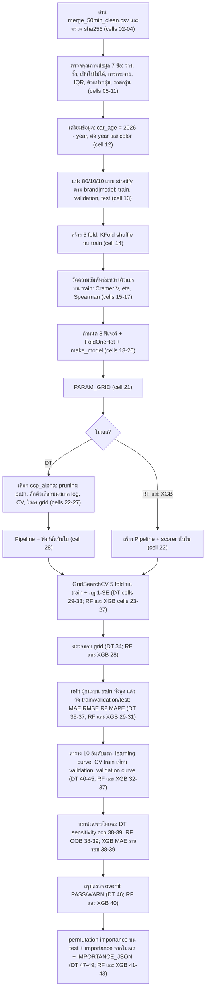

# ขั้นตอนการทำงานของ notebook merge50minC (ฉบับ base: ไม่ scale ฟีเจอร์ ไม่ใช้ log ราคา)

เอกสารนี้อธิบายทีละเซลล์ว่า notebook 3 เล่มทำอะไรตั้งแต่เซลล์แรกถึงเซลล์สุดท้าย เพื่อใช้ทำความเข้าใจและอธิบายวิธีการ

| โมเดล | ไฟล์ | จำนวนเซลล์โค้ด |
|---|---|---|
| Decision Tree (DT) | `training/v5/DT/DT_merge50minC.ipynb` | 49 ([01]-[49]) |
| Random Forest (RF) | `training/v5/RF/RF_merge50minC.ipynb` | 43 ([01]-[43]) |
| XGBoost (XGB) | `training/v5/XGB/XGB_merge50minC.ipynb` | 43 ([01]-[43]) |

> **หมายเหตุเรื่องข้อมูลและตัวเลข (อ่านก่อน)**
> notebook ทั้งสามอ่าน `data/main/merge_50min_clean.csv` และตรวจ sha256 ที่ปักไว้ใน `DATA_SHA256 = "191adb789285fe531bf82521e7ac0892020cbf0bf4325d22f6a657fabaab8aa1"` (ค่าเดียวกันทั้งสามเล่ม; เซลล์ [04] ตัด byte `\r` ออกก่อนคำนวณ แล้ว `assert` ว่าตรงกัน).
> ตอนรันครั้งล่าสุดที่บันทึกไว้ เซลล์ [04] พิมพ์จำนวนแถว **47,001** แถว x 10 คอลัมน์.
> หลังจากนั้นไฟล์ CSV ถูกแก้ (ลบแถวผิดปกติ) เหลือ **46,074** แถว ดังนั้น sha256 ของไฟล์ปัจจุบันจะไม่ตรงกับค่าที่ปักไว้ และ `assert` ในเซลล์ [04] จะล้มถ้ารันตอนนี้ จนกว่าจะแก้ `DATA_SHA256` ให้ตรงกับไฟล์ใหม่ (ผู้เขียนเอกสารนี้ไม่ได้คำนวณ sha256 ของไฟล์ใหม่).
> เอกสารนี้อธิบายขั้นตอนจากโค้ด ส่วนตัวเลขใดที่มาจาก output ที่บันทึกใน notebook (จำนวนแถว ผลวัด พารามิเตอร์ที่ถูกเลือก เวลารัน) จะติดป้ายว่า **"ผลจากการรันครั้งล่าสุดใน notebook (ข้อมูลเวอร์ชันก่อนลบแถวผิดปกติ ต้องรันใหม่)"** ตัวเลขเหล่านั้นจะเปลี่ยนหลังรันใหม่.
> ตารางที่พิมพ์ด้วย `display(...style...)` ไม่ได้ถูกเก็บเป็นข้อความใน output (เก็บได้แต่ข้อความ `print` และรูป) จึงไม่มีตัวเลขในตารางเหล่านั้นในเอกสารนี้ ยกเว้นที่ถูก `print` หรืออยู่ใน JSON.

---

## 1. ภาพรวม

### 1.1 งานที่ทำ
- ทำนาย **ราคารถมือสองเป็นบาท** (คอลัมน์ `price`) จาก 8 ฟีเจอร์ ด้วยโมเดลถดถอย (regression) 3 ชนิด: `DecisionTreeRegressor`, `RandomForestRegressor`, `XGBRegressor`.
- เป้าหมายคือ `price` ดิบ (หน่วยบาท) ไม่แปลง log.
- ฉบับ **base** หมายถึง: ไม่ scale ฟีเจอร์ตัวเลข (ต้นไม้ไม่ต้องการ) และไม่แปลงเป้าหมายเป็น log. ค่าคงที่ใน [03] เก็บ `VARIANT = "base"`. (ฉบับ `_adj` ต่างกันอย่างไร ดูข้อ 8)
- ทั้งสามเล่มใช้โครงเดียวกัน: ตรวจคุณภาพข้อมูล -> เตรียมข้อมูล -> แบ่ง train/validation/test -> สร้าง 5 fold -> เลือกพารามิเตอร์ด้วย GridSearchCV + กฎ 1-SE บน train -> วัดผล -> ตรวจ overfit -> วัดความสำคัญของตัวแปร. เซลล์ [01]-[19] ของทั้งสามเล่มมีเลขและงานเดียวกัน (โค้ดเหมือนกัน ต่างเฉพาะ import, ค่าคงที่ใน [03] และข้อความที่พิมพ์ใน [01], [11]).

### 1.2 อินพุตและเอาต์พุต
- **อินพุต:** ไฟล์ `D:/AI_Workspace/car-project/data/main/merge_50min_clean.csv` (ตัวแปร `DATA_PATH` ใน [02] ที่เดียว). คอลัมน์ดิบ 10 คอลัมน์: `brand, model, year, price, mileage, engine, gear, fuel, color, car_type`. ไฟล์นี้ผ่านการทำความสะอาดนอก notebook ด้วย `data/main/clean_merged_min50.py` (ตามที่เขียนใน [01]) และมีเงื่อนไขว่าทุกรุ่น (brand|model) มีอย่างน้อย 50 แถว.
- **เอาต์พุต:** ไม่เขียนไฟล์ใดลงเครื่อง. ผลออกเป็น (ก) ตาราง/กราฟใน notebook, (ข) บรรทัดข้อความ `RESULT_JSON=...` (เซลล์ผลสรุป: DT [37], RF [31], XGB [31]) และ (ค) `IMPORTANCE_JSON=...` (DT [49], RF [43], XGB [43]). `training/v5/make_report.py` อ่าน output ที่บันทึกนี้ไปทำรายงานเว็บ.

### 1.3 วิธีรัน
- รันบนเครื่องใน VS Code เท่านั้น ไม่ใช้ Colab/Google Drive. เลือก kernel เป็น Python ของ `D:/AI_Workspace/car-project/research/.venv/Scripts/python.exe` แล้วกด Run All. ปิดโปรแกรมที่กินหน่วยความจำก่อน เพราะ grid search ใช้หลาย process.
- ลำดับรันตาม `training/v5/run_order.txt` (ไฟล์นี้ลิสต์ 12 notebook: new_cardb ก่อน แล้ว new_cardb_adj แล้ว merge50minC แล้ว merge50minC_adj; ในแต่ละชุดเรียง DT, RF, XGB). สำหรับเอกสารนี้ลำดับของ 3 เล่มที่เกี่ยวคือ `DT_merge50minC` -> `RF_merge50minC` -> `XGB_merge50minC` (แต่ละเล่มไม่พึ่งผลของเล่มอื่น).
- เวลาที่ใช้ตามที่ notebook พิมพ์ (ผลจากการรันครั้งล่าสุดใน notebook (ข้อมูลเวอร์ชันก่อนลบแถวผิดปกติ ต้องรันใหม่)): GridSearchCV ใช้ DT 185 วินาที (3 นาที 5 วินาที), RF 902 วินาที (15 นาที 2 วินาที), XGB 1,760 วินาที (29 นาที 20 วินาที).
- การตั้ง parallel ใน [03]:

| โมเดล | `SEARCH_JOBS` (process ขนานใน GridSearchCV) | `MODEL_THREADS` (thread ต่อโมเดล) |
|---|---|---|
| DT | 8 | 1 (ใช้จำกัด thread ของ numpy ในแต่ละ process ผ่าน `parallel_backend("loky", inner_max_num_threads=1)` ใน [32]; ตัว `DecisionTreeRegressor` ไม่มี `n_jobs`) |
| RF | 1 (ทีละโมเดล ประหยัดหน่วยความจำ) | 20 (ส่งเป็น `n_jobs` ของ `RandomForestRegressor`) |
| XGB | 6 | 3 (ส่งเป็น `n_jobs` ของ `XGBRegressor` และใช้ใน `parallel_backend` ที่ [26]) รวม 18 core |

---

## 2. Flowchart ของทั้ง pipeline

ลำดับขั้นเดียวกันแบบข้อความ:

1. [02]-[04] ตั้งที่อยู่ไฟล์, ค่าคงที่, อ่าน CSV และตรวจ sha256.
2. [05]-[11] ตรวจคุณภาพข้อมูล 7 ข้อ (ไม่แก้ข้อมูล).
3. [12] สร้าง `car_age`, ตัด `year` และ `color`.
4. [13] แบ่ง train 80% / validation 10% / test 10% แบบ stratify ตาม `brand|model`.
5. [14] สร้าง 5 fold (KFold, shuffle) บน train.
6. [15]-[17] วัดความสัมพันธ์ของตัวแปรทุกคู่บน train (ใช้ดู ไม่ได้ป้อนเข้าโมเดล).
7. [18]-[20] ประกาศ 8 ฟีเจอร์, คลาส `FoldOneHot`, ฟังก์ชัน `make_model()`.
8. [21] ประกาศ `PARAM_GRID`.
9. เฉพาะ DT: [22]-[27] เลือกค่า `ccp_alpha` จากข้อมูลแล้วเติมลง `PARAM_GRID`.
10. ต่อ `Pipeline([encode, model])` และเตรียมตัวนับใบ (DT [28]; RF/XGB [22]).
11. ประกาศฟังก์ชันกฎ 1-SE และทดสอบด้วยตัวอย่างปลอม (DT [29]-[30]; RF/XGB [23]-[24]).
12. ตั้งและรัน `GridSearchCV` บน train ด้วย 5 fold, `refit` ด้วยกฎ 1-SE (DT [31]-[32]; RF/XGB [25]-[26]).
13. สรุปผลกฎ 1-SE และตรวจขอบ grid (DT [33]-[34]; RF/XGB [27]-[28]).
14. ประกาศ `score()` แล้ววัดผลผู้ชนะบน train/validation/test และพิมพ์ `RESULT_JSON` (DT [35]-[37]; RF/XGB [29]-[31]).
15. การตรวจเพิ่ม: ตาราง 10 อันดับแรก, learning curve, ตาราง CV train เทียบ validation, validation curve (DT [40]-[45]; RF/XGB [32]-[37]) และเซลล์เฉพาะโมเดล (DT [38]-[39] sensitivity ccp; RF [38]-[39] OOB; XGB [38]-[39] MAE รายรอบ).
16. สรุปตรวจ overfit (DT [46]; RF/XGB [40]).
17. ความสำคัญของตัวแปร: permutation บน test, importance จากโมเดล, เทียบอันดับ, พิมพ์ `IMPORTANCE_JSON` (DT [47]-[49]; RF/XGB [41]-[43]).

---

## 3. Pipeline ส่วนที่ใช้ร่วมกัน (เซลล์ [01]-[19] ของทั้งสามเล่ม)

### 3.0 ข้อมูลที่ใช้โดยรวม
- **คอลัมน์ดิบ (10):** `brand, model, year, price, mileage, engine, gear, fuel, color, car_type`.
- **คอลัมน์ที่สร้างเพิ่ม:** `car_age = CURRENT_YEAR - year` โดย `CURRENT_YEAR = 2026` ([03]; หมายถึงปีที่เก็บข้อมูล ไม่ใช่ปีที่รัน notebook).
- **คอลัมน์ที่ตัดทิ้ง:** `year` (ซ้ำซ้อนกับ `car_age`) และ `color` (โปรเจกต์ตัดสินใจไม่ใช้สี).
- **เป้าหมาย:** `price` (บาท).
- **ฟีเจอร์ 8 ตัว** (`features = NUM_COLS + CAT_COLS` ใน [18]):

| กลุ่ม | คอลัมน์ | ตัวแปรใน [03] |
|---|---|---|
| ตัวเลข (3) | `engine`, `mileage`, `car_age` | `NUM_COLS` |
| ประเภทกลุ่ม (5) | `brand`, `model`, `car_type`, `fuel`, `gear` | `CAT_COLS` |

- **การเข้ารหัสตัวแปรกลุ่ม:** one-hot ด้วยคลาส `FoldOneHot` ใน [19] (ดูรายละเอียดในหัวข้อ [19]) ฟีเจอร์ตัวเลขส่งผ่านเป็น `float` ไม่ scale.

### 3.1 ค่าคงที่ใน [03]

| ตัวแปร | ค่า | ความหมาย |
|---|---|---|
| `SEED` | 99 | เลขสุ่มกลางที่ใช้ทุกที่ที่มีการสุ่ม |
| `N_FOLDS` | 5 | จำนวน fold ของ cross-validation |
| `NUM_COLS` / `CAT_COLS` | ดูตารางข้างบน | |
| `DATA_SHA256` | `191adb78...abaab8aa1` | ลายนิ้วมือของไฟล์ข้อมูล |
| `MODEL_NAME`, `VERSION` | `DT`/`RF`/`XGB`, `v5` | ใช้ใน JSON |
| `CURRENT_YEAR` | 2026 | คำนวณ `car_age` |
| `TRAIN_SIZE, VAL_SIZE, TEST_SIZE` | 0.8, 0.1, 0.1 | สัดส่วนแบ่งข้อมูล |
| `LC_FRACTIONS` | `np.arange(1, 11) / 10` (0.1 ถึง 1.0) | สัดส่วน train ที่ใช้วาด learning curve |
| `LC_REPEATS` | 5 | จำนวนรอบสุ่มซ้ำต่อสัดส่วน |
| `SEARCH_JOBS`, `MODEL_THREADS` | DT 8 / 1; RF 1 / 20; XGB 6 / 3 | ดูข้อ 1.3 |
| `MAE_AXIS` | (20000, 90000) | แกน MAE (บาท) ของ learning curve และ validation curve |
| `R2_AXIS` | (0.8, 1.0) | แกน R2 ของ learning curve |
| `ROWS_AXIS` | (0, 40000) | แกน x ของ learning curve |
| `FOLD_AXIS`, `MAE_BAR_AXIS` | (-0.5, 4.5), (0, 70000) | แกนกราฟแท่งต่อ fold |
| `PERM_AXIS`, `SHARE_AXIS` | (0, 150000), (0, 1.0) | แกนกราฟ importance |
| `MAE_CCP_AXIS` (DT), `MAE_OOB_AXIS` (RF), `MAE_ROUND_AXIS` (XGB) | (50000, 130000), (52000, 54000), (30000, 70000) | แกนกราฟเฉพาะโมเดล (ประกาศในทุกเล่ม แต่ใช้เฉพาะเล่มที่เกี่ยวข้อง) |
| `RUN_ID`, `DATASET`, `VARIANT` | `<MODEL>_merge50minC`, `merge_50min_clean.csv`, `base` | ใช้ใน JSON |

ค่าเฉพาะต่อโมเดลที่เพิ่มใน [03]: DT มี `MIN_LEAVES = 20`, `CCP_N_CANDIDATES = 20`, `CCP_NEIGHBOURS = 3`; RF มี `N_TREES = 300`, `OOB_TREE_COUNTS = [50, 100, 150, 200, 300, 400, 600, 800, 1000]`; XGB มี `LEARNING_RATE = 0.1`.

### 3.2 รายเซลล์

**[01] คำอธิบาย อภิธานศัพท์ และ import ทั้งหมด**
- ทำอะไร: เซลล์เดียวที่ import ทุกอย่าง (hashlib, json, time, pathlib, numpy, pandas, matplotlib, seaborn, scipy `chi2_contingency`, sklearn, joblib; XGB เพิ่ม `xgboost.XGBRegressor`). comment หัวเซลล์อธิบายวิธีรัน แผนที่เซลล์ และอภิธานศัพท์ (train/validation/test, fold, CV, hyperparameter, MAE, RMSE, MAPE, R2, overfit, underfit).
- อินพุต/เอาต์พุต: ไม่มีข้อมูลเข้า พิมพ์ "import ครบแล้ว".
- ต่างกันระหว่างเล่ม: DT import `DecisionTreeRegressor`, `parallel_backend`, `cross_val_score`, `cross_validate`, `validation_curve`; RF import `RandomForestRegressor` (ไม่ import `parallel_backend`, `cross_validate`, `validation_curve` เพราะไม่ใช้); XGB import `parallel_backend`, `cross_validate`, `validation_curve`, `XGBRegressor`.

**[02] กำหนดที่อยู่ไฟล์ข้อมูล**
- กำหนด `DATA_PATH = "D:/AI_Workspace/car-project/data/main/merge_50min_clean.csv"`. แก้ที่เดียวถ้าย้ายไฟล์.

**[03] ค่าคงที่ของการทดลอง**
- รวมค่าที่ตั้งเองทั้งหมดไว้ที่เดียว (ตารางข้อ 3.1) เพื่อไม่ให้มี "เลขมายากล" กระจายในโค้ด และให้ผลซ้ำได้ด้วย `SEED`. พิมพ์สรุปค่าหลัก. แกนกราฟถูกล็อกเพื่อให้กราฟของ DT/RF/XGB เทียบกันที่ความสูงเดียวกัน.

**[04] อ่าน CSV และตรวจ sha256**
- ขั้นตอน: อ่านไฟล์เป็น byte, ตัด `b"\r"` ออก, คำนวณ sha256, `assert` เท่ากับ `DATA_SHA256`; ถ้าผ่านจึง `pd.read_csv(..., encoding="utf-8-sig")` เป็น `raw_df`.
- ทำไม: ยืนยันว่าเป็นข้อมูลชุดเดียวกับที่ใช้ตอนทดลอง (การตัด `\r` ทำให้ผลไม่ขึ้นกับ line ending ของ Windows/Linux).
- พิมพ์: จำนวนแถว/คอลัมน์ และ 5 แถวแรก. ผลจากการรันครั้งล่าสุดใน notebook (ข้อมูลเวอร์ชันก่อนลบแถวผิดปกติ ต้องรันใหม่): 47,001 แถว x 10 คอลัมน์.

**[05] ตรวจคุณภาพ 1: ค่าว่าง**
- คำนวณ `raw_df.isna().sum()` และสัดส่วน % ต่อคอลัมน์; แสดงตารางและกราฟแท่ง (ถ้าไม่มีค่าว่างเลย ใส่ข้อความ "No missing values" บนกราฟ).
- ผลจากการรันครั้งล่าสุดใน notebook (ข้อมูลเวอร์ชันก่อนลบแถวผิดปกติ ต้องรันใหม่): "ไม่พบค่าว่าง".

**[06] ตรวจคุณภาพ 2: แถวซ้ำ**
- นับแถวที่ "ซ้ำกับแถวก่อนหน้า" (`duplicated(keep="first")` ไม่นับแถวแรกที่เจอ) ตาม 3 นิยาม: ทุกคอลัมน์; ทุกคอลัมน์ยกเว้น `price`; ทุกคอลัมน์ยกเว้น `color`. แสดงตารางและกราฟแท่ง.
- ความหมาย: แถวที่ต่างกันแค่ price เป็นธงเตือน; แถวที่ต่างกันแค่ color ถือเป็นรถคนละคัน (ตามกติกาโปรเจกต์).
- ผลจากการรันครั้งล่าสุดใน notebook (ข้อมูลเวอร์ชันก่อนลบแถวผิดปกติ ต้องรันใหม่): ซ้ำทุกคอลัมน์ 0; ต่างกันแค่ price 9,103 แถว; ต่างกันแค่ color 1,467 แถว.

**[07] ตรวจคุณภาพ 3: ค่าที่เป็นไปไม่ได้**
- นับแถวที่ฝ่าฝืน 4 กฎ: `price <= 0`, `engine <= 0`, `mileage < 0`, `year > 2026`. ควรเป็น 0 ทุกกฎ. แสดงตารางและกราฟแท่ง.
- ผลจากการรันครั้งล่าสุดใน notebook (ข้อมูลเวอร์ชันก่อนลบแถวผิดปกติ ต้องรันใหม่): ไม่พบการฝ่าฝืน.

**[08] ตรวจคุณภาพ 4: การกระจายของตัวเลข**
- `describe()` ของ `price, engine, mileage, year`; histogram (50 bins) และ boxplot ของแต่ละตัว; คำนวณ skewness แล้วจัดป้าย: > 1 = เบ้ขวาชัดเจน, < -1 = เบ้ซ้ายชัดเจน, อื่น ๆ = ไม่เบ้มาก.
- ผลจากการรันครั้งล่าสุดใน notebook (ข้อมูลเวอร์ชันก่อนลบแถวผิดปกติ ต้องรันใหม่): skew price +1.65 (เบ้ขวาชัดเจน), engine +0.20, mileage +0.54, year -0.80 (ไม่เบ้มาก).

**[09] ตรวจคุณภาพ 5: ค่าผิดปกติ (IQR)**
- กฎ Tukey ต่อคอลัมน์ `price, engine, mileage, year`: `Q1`, `Q3` (quantile 0.25/0.75), `IQR = Q3 - Q1`, รั้วล่าง `Q1 - 1.5*IQR`, รั้วบน `Q3 + 1.5*IQR`; นับแถวต่ำกว่า/สูงกว่ารั้ว. **ไม่ลบแถวใดทิ้ง** (อาจเป็นข้อมูลจริง).
- ผลจากการรันครั้งล่าสุดใน notebook (ข้อมูลเวอร์ชันก่อนลบแถวผิดปกติ ต้องรันใหม่): ค่านอกรั้วรวม 3,690 ค่า (นับซ้ำข้ามคอลัมน์ได้).

**[10] ตรวจคุณภาพ 6: ตัวแปรกลุ่ม**
- ต่อคอลัมน์ `brand, model, car_type, fuel, gear, color`: จำนวนระดับ, ระดับที่พบบ่อยสุดและสัดส่วน, จำนวนแถวของระดับที่เล็กสุด. กราฟ barh ของ 5 คอลัมน์ (ไม่วาด `model`).
- ผลจากการรันครั้งล่าสุดใน notebook (ข้อมูลเวอร์ชันก่อนลบแถวผิดปกติ ต้องรันใหม่): ระดับที่เล็กสุดในทุกคอลัมน์กลุ่มมี 1 แถว (หมายถึงมีอย่างน้อยหนึ่งคอลัมน์ที่มีระดับปรากฏครั้งเดียว; ตารางไม่ถูกเก็บจึงไม่ทราบว่าคอลัมน์ใด).

**[11] ตรวจคุณภาพ 7: จำนวนรถต่อรุ่น**
- `rows_per_model = raw_df.groupby(["brand","model"]).size()` (1 รุ่น = 1 คู่ brand+model); พิมพ์จำนวนรุ่น, ต่ำสุด, มัธยฐาน, สูงสุด, 10 รุ่นที่แถวน้อยสุด, histogram พร้อมเส้นแดงที่ 50; ถ้าทุกรุ่น >= 50 แถวพิมพ์ว่าผ่านเงื่อนไขไฟล์.
- ผลจากการรันครั้งล่าสุดใน notebook (ข้อมูลเวอร์ชันก่อนลบแถวผิดปกติ ต้องรันใหม่): 115 รุ่น, ต่ำสุด 52, มัธยฐาน 193, สูงสุด 2,712.
- ต่างกันระหว่างเล่ม: เฉพาะข้อความ label/print.

**[12] เตรียมข้อมูล: car_age และตัดคอลัมน์**
- `df = raw_df.copy()`; `df["car_age"] = CURRENT_YEAR - df["year"]`; `df = df.drop(columns=["year","color"])`; `assert df[NUM_COLS + CAT_COLS + ["price"]].notna().all().all()`.
- ทำไม: ตัด `year` เพราะ `car_age` ให้ข้อมูลเดียวกัน; ตัด `color` ตามการตัดสินใจของโปรเจกต์; สร้างจาก `raw_df.copy()` เพื่อรันซ้ำได้โดยไม่แก้ `raw_df`; ไม่เปลี่ยนชื่อคอลัมน์ (`engine, fuel, gear`) ตามไฟล์ข้อมูล.
- ผลจากการรันครั้งล่าสุดใน notebook (ข้อมูลเวอร์ชันก่อนลบแถวผิดปกติ ต้องรันใหม่): 47,001 แถว x 9 คอลัมน์ คอลัมน์ `['brand','model','price','mileage','engine','gear','fuel','car_type','car_age']`.

**[13] แบ่ง train / validation / test**
- ขั้นตอน:
  1. `model_key = df["brand"] + "|" + df["model"]` (เช่น `HONDA|CR-V`; ใช้เฉพาะตอนแบ่ง ไม่เข้าตารางและโมเดลไม่เห็น).
  2. `train, temp = train_test_split(df, train_size=0.8, stratify=model_key, random_state=99)`.
  3. `val, test = train_test_split(temp, test_size=0.1/(0.1+0.1)=0.5, stratify=model_key.loc[temp.index], random_state=99)`.
- ผลที่ได้: train 80%, validation 10%, test 10% โดยทุกรุ่น (brand|model) กระจายอยู่ในทั้ง 3 ชุดตามสัดส่วนเดียวกัน.
- ขนาด: ตารางขนาดชุดไม่ได้ถูกเก็บเป็นข้อความ. ที่ยืนยันได้จาก output ที่บันทึก: train = 37,600 แถว (learning curve ใน [41]/[33] ใช้ขนาดสูงสุด 37,600). ที่เหลือ 9,401 แถวแบ่งครึ่ง คำนวณตามกฎของ sklearn ได้ validation 4,700 และ test 4,701 (คำนวณจาก 47,001 ไม่ได้อ่านจาก output; ต้องคำนวณใหม่เมื่อข้อมูลเหลือ 46,074 แถว).
- ข้อควรระวังที่ comment ระบุ: หลังตัด `color` อาจมีแถวใน validation/test ที่ค่าทุกคอลัมน์ที่ใช้ (รวมราคา) ตรงกับแถวใน train แม้ต้นทางต่างกันที่สี; นี้ทำให้ validation/test ง่ายขึ้นเล็กน้อยได้.

**[14] สร้าง 5 fold**
- `folds = list(KFold(N_FOLDS, shuffle=True, random_state=SEED).split(train))` ได้ลิสต์ของคู่ (index แถวสอน, index แถวตรวจ) บน train เท่านั้น. สร้างครั้งเดียวแล้วทุกขั้นตอนหลังใช้ร่วม (ทุกการเปรียบเทียบจึงใช้ fold ชุดเดียวกัน).
- `shuffle=True` เพราะข้อมูลอาจเรียงตามยี่ห้อหรือราคา. ขนาด: แต่ละ fold สอน 80% ตรวจ 20% ของ train (จาก train = 37,600: สอน 30,080 ตรวจ 7,520 คำนวณ ไม่ใช่ที่อ่านจาก output).
- validation และ test ไม่ถูกใช้จนถึงขั้นวัดผลสุดท้าย.

**[15] ฟังก์ชันวัดความสัมพันธ์**
- `cramers_v(x, y)`: ตาราง crosstab -> `chi2_contingency(table, correction=False)[0]`; `V = sqrt(chi2 / (n * (min(rows, cols) - 1)))` ช่วง 0 ถึง 1.
- `correlation_ratio(categories, values)` (eta): `eta = sqrt(SS_between / SS_total)` โดย `SS_between = sum((group_mean - overall_mean)^2)` ต่อแถว; ช่วง 0 ถึง 1.
- เช็กตัวเองด้วย `assert`: `cramers_v(brand, brand) = 1` และ eta ของ fuel กับค่าที่ขึ้นกับ fuel อย่างเดียว = 1.
- ข้อควรระวัง: 3 ตัววัด (Spearman, Cramer V, eta) ไม่ได้อยู่บนสเกลเดียวกันเป๊ะ เทียบข้ามชนิดได้คร่าว ๆ.

**[16] ความสัมพันธ์ทุกคู่ (heatmap 9x9)**
- ตัวแปร 9 ตัว = 8 ฟีเจอร์ + `price`, ใช้ข้อมูล **train เท่านั้น**. ทุกคู่ (36 คู่):
  - ตัวเลข-ตัวเลข: `abs(Spearman)`.
  - กลุ่ม-กลุ่ม: Cramer V.
  - กลุ่ม-ตัวเลข: eta.
- แสดง heatmap (vmin 0, vmax 1) และตารางทั้ง 36 คู่เรียงจากมากไปน้อย. ใช้ดูเพื่อเข้าใจข้อมูล ไม่ได้ป้อนผลเข้าโมเดล.

**[17] Spearman ของตัวแปรตัวเลข**
- `train[NUM_COLS + ["price"]].corr(method="spearman")` (4x4 มีเครื่องหมาย) แสดง heatmap (-1 ถึง 1) และตาราง. ใช้ train เท่านั้น. สัมพันธ์ไม่ใช่เหตุและผล.

**[18] รายชื่อฟีเจอร์**
- `features = NUM_COLS + CAT_COLS` (8 ตัว: `engine, mileage, car_age, brand, model, car_type, fuel, gear`). ไม่มีขั้นคัดเลือกฟีเจอร์ในเล่มนี้.

**[19] คลาส FoldOneHot**
- คลาส `TransformerMixin, BaseEstimator` ที่รับ `numeric_columns`, `categorical_columns` (`__init__` เก็บ argument ตามเดิมเพื่อให้ `clone` ใช้ได้).
- `fit(X)`: จำคอลัมน์ตัวเลข/กลุ่มที่อยู่ใน X; สำหรับแต่ละคอลัมน์กลุ่มนับ `value_counts`, เรียงตามชื่อระดับก่อน (`sort_index`) แล้วเรียงตามความถี่มาก->น้อยแบบ stable (`sort_values(ascending=False, kind="stable")`), เก็บทุกระดับ **ยกเว้นระดับแรก (พบบ่อยที่สุด = ระดับอ้างอิง)** ลงใน `levels_[col]`. ถ้าความถี่เท่ากัน ระดับชื่อน้อยกว่า (ตามลำดับเรียง) ชนะเป็นระดับอ้างอิง.
- `transform(X)`: คอลัมน์ตัวเลขแปลงเป็น `float` (ไม่ scale); แต่ละระดับใน `levels_` สร้างคอลัมน์ `"<col>=<level>"` ค่า 1.0 ถ้าแถวมีระดับนั้นไม่เช่นนั้น 0.0 (เทียบแบบ broadcasting `values[:, None] == levels`); ผลคือ `pd.concat` ของตัวเลขตามด้วย dummy.
- ระดับอ้างอิง = ศูนย์ทุก dummy ของคอลัมน์นั้น. **ระดับที่ไม่เคยเจอตอน fit (unseen level)** ก็ได้ศูนย์ทุกคอลัมน์เช่นกัน จึงไม่ทำให้โปรแกรมพัง (มีผลเท่ากับถูกจัดเป็นระดับอ้างอิง).
- `get_feature_names_out()` คืนชื่อคอลัมน์ผลลัพธ์ตามลำดับเดียวกับ `transform` (ใช้ใน importance).
- **ทำไม fit ภายในแต่ละ fold:** เมื่อใช้เป็นขั้น `encode` ของ `Pipeline` ทุก fold ใน CV จะ `fit` ใหม่จากแถวสอนของ fold นั้นเท่านั้น รายชื่อระดับและระดับอ้างอิงจึงไม่ใช้ข้อมูลฝั่งตรวจ (ไม่เกิด information leak).
- เซลล์นี้เพียงนิยามคลาส ไม่มีการแปลงข้อมูล (เซลล์ที่เรียกใช้จริง: DT [22]/[28], RF/XGB [22]).

---

## 4. ส่วนเฉพาะของแต่ละโมเดล

### 4.0 สิ่งที่ใช้ร่วมกันของส่วนค้นหาและวัดผล

**Pipeline:** `Pipeline([("encode", FoldOneHot(NUM_COLS, CAT_COLS)), ("model", make_model())])` (ชื่อ step ต้องคงไว้ เพราะ grid ใช้ prefix `model__`). ใน CV ทุก fold fit ทั้งสาย.

**GridSearchCV** (ทั้ง 3 เล่มตั้งเหมือนกันยกเว้น scoring เพิ่ม `leaves` ใน RF/XGB):
- `cv=folds` (5 fold จาก [14]), ป้อนเฉพาะ `train[features]` และราคา `train["price"]` (หน่วยบาท).
- `scoring` = `{"MAE": "neg_mean_absolute_error", "RMSE": "neg_root_mean_squared_error", "MAPE": "neg_mean_absolute_percentage_error", "R2": "r2"}` (RF และ XGB เพิ่ม `"leaves": count_leaves_scorer`).
- `refit=<ฟังก์ชันกฎ 1-SE>` (DT: `refit_1se`; RF/XGB: `select_1se`), `return_train_score=True`, `error_score="raise"`, `n_jobs=SEARCH_JOBS`, `pre_dispatch=SEARCH_JOBS`.
- เมื่อ `refit` เป็นฟังก์ชัน sklearn เลือก index ที่ฟังก์ชันคืน แล้ว fit ผู้ชนะใหม่บน **train ทั้งชุด** (ไม่รวม validation/test) เก็บเป็น `search.best_estimator_` และ `search.best_params_`. ไม่มี `best_score_`.

**กฎ 1-SE (สูตรที่เขียนในโค้ดของ `select_1se`):**
1. `cv_mae = -mean_test_MAE` (บาท บวก).
2. `best = argmin(cv_mae)` (ถ้าเสมอได้ index แรก).
3. `SE = std_test_MAE[best] / sqrt(n_splits)` โดย `std_test_MAE` ของ sklearn คำนวณแบบ `ddof=0`; `n_splits` = จำนวนคีย์ `split*_test_MAE` (= 5).
4. `limit = cv_mae[best] + SE`; `eligible = {i : cv_mae[i] <= limit}`.
5. เลือก `i` ใน eligible ที่ทำให้ tuple `(leaves[i], cv_mae[i], i)` น้อยสุด (เปรียบเทียบแบบ lexicographic): ใบน้อยสุดก่อน, ถ้าเสมอ CV MAE ต่ำกว่า, ถ้ายังเสมอ index ต่ำกว่า.
- ที่มาของแนวคิด: Breiman et al. (CART, 1984) และ Hastie, Tibshirani, Friedman (ESL ฉบับ 2, §7.10) ตามที่ comment อ้าง; เป็น heuristic ไม่ใช่การทดสอบทางสถิติ.
- ความต่างของนิยาม `leaves` ระหว่างโมเดลอยู่ในหัวข้อ 4.1-4.3.

**ฟังก์ชัน `score(actual, predicted)`** (DT [35]; RF/XGB [29]) คืน dict:
- `RMSE = mean_squared_error(actual, predicted) ** 0.5`
- `MAE = mean_absolute_error(actual, predicted)`
- `MAPE = np.mean(np.abs(predicted / actual - 1))` (เป็นสัดส่วน 0.10 = 10% ไม่ใช่เปอร์เซ็นต์)
- `R2 = r2_score(actual, predicted)`
- ไม่ปัดเศษ. ทั้งสามเล่มโค้ดเหมือนกัน.

**วัดผล** (DT [36]; RF/XGB [30]): `model = search.best_estimator_`; วนบน train, validation, test: `score(part["price"], model.predict(part[features]))`. test ใช้รายงานผลเท่านั้น ไม่เคยใช้เลือกพารามิเตอร์. ผลสรุปพิมพ์เป็น `RESULT_JSON=` (run_id, dataset, variant, model, version, features, best_params, train, validation, test).

**Learning curve** (DT [41]-[42]; RF/XGB [33]-[34], โค้ดเหมือนกัน):
- `sizes = unique(clip(int(LC_FRACTIONS * len(train)), 2, len(train)))` (จาก train 37,600: 3,760, 7,520, ..., 37,600).
- ทำ 5 รอบ (`LC_REPEATS`); แต่ละรอบสร้างลำดับสุ่มของแถว train ด้วย `np.random.SeedSequence([SEED, repeat])` และ `default_rng(...).permutation`; ชุดเล็กเป็นส่วนหนึ่งของชุดใหญ่ (prefix ของลำดับเดียวกัน).
- ทุกขนาด: `clone(search.best_estimator_)` (พารามิเตอร์ผู้ชนะ) fit บนแถวย่อย; บันทึก train MAE, test MAE, train R2, test R2 (test = test set จริง ชุดเดียวกันทุกขนาด).
- สรุปเป็นค่าเฉลี่ยและ sd (`std` ของ pandas, ddof=1) ต่อขนาด. กราฟ 2 ช่อง (MAE, R2) เส้น mean พร้อมแถบ ± 1 sd; แกนล็อกตาม [03] ถ้ามีค่านอกแกนจะพิมพ์ WARN.
- หมายเหตุ: ใช้ test set คำนวณเส้นนี้เพื่อการวินิจฉัยเท่านั้น ไม่ได้ย้อนไปเลือกหรือแก้โมเดล.

**ตาราง CV train เทียบ validation** (DT [43]; RF/XGB [35]): ต่อ fold แสดง train MAE, validation MAE (หมายถึงแถวตรวจของ fold), MAE gap = validation - train, gap % ของ validation MAE, train R2, validation R2, R2 gap = train - validation; แถวสรุป mean และ sd (`ddof=0`); กราฟแท่งต่อ fold.
- DT และ XGB: เรียก `cross_validate(clone(search.best_estimator_), train[features], train["price"], cv=folds, scoring={MAE, R2}, return_train_score=True)` ซึ่งฝึกใหม่ 5 ครั้ง.
- RF: ไม่ฝึกใหม่ อ่านค่า `split{k}_train_MAE`, `split{k}_test_MAE`, `split{k}_train_R2`, `split{k}_test_R2` ที่ index ผู้ชนะจาก `cv_results_`.

**Validation curve** (DT [44]-[45]; RF/XGB [36]-[37]): เปลี่ยนพารามิเตอร์ที่อยู่ใน `PARAM_GRID` ทีละตัว (ตัวอื่นคงที่เป็นค่าผู้ชนะ) แล้วดู train MAE และ CV MAE:
- DT และ XGB: ใช้ `validation_curve(clone(search.best_estimator_), ..., param_name="model__"+name, param_range=values, cv=folds, scoring="neg_mean_absolute_error")` (ฝึกใหม่); คำนวณ mean และ sd (`ddof=0`) ข้าม fold.
- RF: ไม่ฝึกใหม่ ค้นแถวใน `cv_results_["params"]` ที่เท่ากับ "พารามิเตอร์ผู้ชนะ เปลี่ยนเฉพาะค่าที่กำลังดู" แล้วใช้ `mean_train_MAE`, `std_train_MAE`, `mean_test_MAE`, `std_test_MAE` ที่ index นั้น (ใช้ได้เพราะ grid เป็น grid เต็มของ 2 พารามิเตอร์).
- ตารางต่อพารามิเตอร์: value, train MAE mean, CV MAE mean, CV MAE sd, gap = CV - train. กราฟแกน x ใช้ตำแหน่ง (ระยะห่างเท่ากัน) เส้นประดำคือค่าผู้ชนะ. ตารางและกราฟนี้ใช้ train/folds เดิม จึงไม่ใช่ผลประเมินอิสระ.

**ตาราง 10 อันดับแรก** (DT [40]; RF/XGB [32]): `all_results = DataFrame(search.cv_results_)`, เรียง `mean_test_MAE` จากมากไปน้อย (คือ CV MAE ต่ำสุดก่อน เพราะเก็บเป็นค่าลบ; `kind="stable"`), เอา 10 แถวบน และเติมแถวผู้ชนะถ้าไม่อยู่ใน 10 อันดับ. คอลัมน์: candidate, chosen (`*` = ผู้ชนะ), eligible (อยู่ในช่วง 1-SE), leaves, rank, พารามิเตอร์, cv_mae, cv_mae_sd, train_mae, gap. DT แสดง leaves เฉพาะแถว eligible; RF/XGB แสดง `mean_test_leaves` ทุกแถว.

**ความสำคัญของตัวแปร** (DT [47]-[49]; RF/XGB [41]-[43], โค้ดเหมือนกันทั้งสามเล่ม ยกเว้นสาขา XGB ใน [48]/[42]):
1. *Permutation importance บน test:* `permutation_importance(search.best_estimator_, test[features], test["price"], scoring="neg_mean_absolute_error", n_repeats=10, random_state=SEED)`. สลับคอลัมน์ดิบ (ก่อน encode) ทีละคอลัมน์ 10 รอบ วัด MAE ที่เพิ่มเป็นบาท; ตารางคอลัมน์ `mean`, `std`, `share (%) = 100 * mean / sum(mean)` (ผลรวมมีเครื่องหมาย ไม่ตัดค่าลบทิ้ง; ถ้าผลรวมเป็นศูนย์ share = 0) เรียงตาม mean. มี `assert len(features) == 8`.
2. *Importance จากโมเดล:* เอา importance ของคอลัมน์ผลลัพธ์ของ `FoldOneHot` (dummy) รวมกลับเป็นตัวแปรดิบโดยตัดชื่อที่ `=` (`encoded_name.split("=", 1)[0]`) แล้ว normalize ให้ผลรวม = 1 (`assert np.isclose(sum, 1.0)`). DT/RF ใช้ `feature_importances_` (mean decrease of impurity); XGB ใช้ `booster.get_score(importance_type="gain")` (ตรวจชื่อ feature ของ booster ตรงกับ encoder; ฟีเจอร์ที่ไม่เคยถูกใช้แตกกิ่งได้ 0).
3. *เทียบอันดับ:* รวมสองตารางด้วย `merge(validate="one_to_one")`, จัดอันดับ (`rank(method="min", ascending=False)`) ทั้งสองวิธี; พิมพ์ `IMPORTANCE_JSON=` (run_id, permutation{ตัวแปร:{mean,std}}, model_based{ตัวแปร: สัดส่วน}).
- comment ระบุข้อควรระวัง: ถ้าสองวิธีขัดกันให้เชื่อ permutation บนข้อมูลที่ไม่เคยเห็นมากกว่า (importance แบบ impurity/gain อาจเอนเอียงไปทางตัวแปรที่มีระดับมาก).

### 4.1 Decision Tree (DT) (เซลล์ [20]-[49])

#### 4.1.1 `make_model()` ([20]) คืน `DecisionTreeRegressor` 12 พารามิเตอร์

| พารามิเตอร์ | ค่าใน `make_model()` | ความหมาย |
|---|---|---|
| `criterion` | `"squared_error"` | วัดคุณภาพการแตกกิ่งด้วย MSE |
| `splitter` | `"best"` | ลองทุกจุดตัดแล้วเลือกจุดที่ดีที่สุด ไม่สุ่ม |
| `max_depth` | `None` **[grid]** | ความลึกสูงสุด None = ไม่จำกัด |
| `min_samples_split` | 2 | จำนวนแถวขั้นต่ำในโหนดก่อนแตกกิ่ง (ค่าเริ่มต้น ไม่ได้ทดสอบการปรับ) |
| `min_samples_leaf` | 1 **[grid]** | จำนวนแถวขั้นต่ำต่อใบ |
| `min_weight_fraction_leaf` | 0.0 | ไม่ใช้ (ทุกแถวน้ำหนักเท่ากัน) |
| `max_features` | `None` | ทุกการแตกกิ่งเห็นตัวแปรครบ |
| `random_state` | `SEED` (99) | ใช้ตัดสินกรณีจุดตัดดีเท่ากัน |
| `max_leaf_nodes` | `None` | ไม่จำกัดจำนวนใบ |
| `min_impurity_decrease` | 0.0 | แตกกิ่งได้แม้ลด error น้อย |
| `ccp_alpha` | 0.0 **[grid]** | ค่าตัดกิ่งหลังโตเสร็จ (เลือกจาก [22]-[26]) |
| `monotonic_cst` | `None` | ไม่บังคับทิศทางความสัมพันธ์ |

ป้าย **[grid]** = ค่าที่ GridSearchCV เขียนทับ (`max_depth`, `min_samples_leaf`, `ccp_alpha`).

#### 4.1.2 การเลือก `ccp_alpha` ก่อน grid ([22]-[27])
ใช้ train เท่านั้น (ไม่แตะ validation/test) ราคาเป็นบาทไม่แปลง log. `ccp_alpha` คือค่าปรับต่อหนึ่งใบ (cost-complexity pruning) ยิ่งมากยิ่งตัดมาก; 0 = ไม่ตัด.

- **[21] PARAM_GRID ตั้งต้น:** `{"max_depth": [10, 15, 20, 25, None], "min_samples_leaf": [1, 5, 7, 9, 12, 15]}` = 5 x 6 = 30 ชุด (ยังไม่รวม `ccp_alpha`).
- **[22] pruning path:** `encoded_train = FoldOneHot(...).fit_transform(train[features])` (fit บน train ทั้งชุด); `DecisionTreeRegressor(random_state=SEED).cost_complexity_pruning_path(encoded_train, train_prices)`; `positive_alphas = unique(ccp_alphas[ccp_alphas > 0])`. ผลจากการรันครั้งล่าสุดใน notebook (ข้อมูลเวอร์ชันก่อนลบแถวผิดปกติ ต้องรันใหม่): 13,392 ค่า, น้อยสุด 2.910e-11, มากสุด 1.696e+10.
- **[23] เก็บ alpha ที่ต้นไม้ยังเหลือมากกว่า `MIN_LEAVES` (20) ใบ:** ฟังก์ชัน `count_leaves(alpha)` ฝึก `DecisionTreeRegressor(random_state=SEED, ccp_alpha=alpha)` บน train แล้วนับใบ (มี cache). เริ่มจาก alpha มากสุด ลดทีละค่าจน `count_leaves(...) > 20` (while loop) -> `over_min_alphas = positive_alphas[:cut]`, `boundary_alpha = over_min_alphas[-1]`. ผลจากการรันครั้งล่าสุดใน notebook (...ต้องรันใหม่): `boundary_alpha` 8.117e+08 (21 ใบ), เก็บ 13,374 ค่า, ฝึกต้นไม้เพื่อนับใบ 19 ต้น.
- **[24] เลือกตัวเลือกบนสเกล log:** `low = max(over_min_alphas[0], over_min_alphas[-1] * 1e-6)`; `targets = linspace(log(low), log(over_min_alphas[-1]), CCP_N_CANDIDATES=20)`; แต่ละ target เลือก alpha ที่ใกล้สุดบนสเกล log จาก `over_min_alphas` (argmin คืนตัวแรกเมื่อเสมอ); `np.unique` ตัดซ้ำ -> `candidate_alphas`. ผลจากการรันครั้งล่าสุดใน notebook (...ต้องรันใหม่): low = 8.117e+02, ได้ 20 ตัว. ค่า 1e-6 และ 20 เป็น heuristic (comment ยอมรับว่ายังไม่ยืนยันว่าเหมาะที่สุด).
- **[25] CV MAE ต่อตัวเลือก:** ต่อ alpha ใช้ `Pipeline([FoldOneHot, DecisionTreeRegressor(random_state=SEED, ccp_alpha=alpha, max_depth=None, min_samples_leaf=1)])` และ `cross_val_score(..., cv=folds, scoring="neg_mean_absolute_error")`; `cv_mae = -mean(scores)`; เก็บ `ccp_table` (alpha, cv_mae, leaves).
- **[26] ใส่ลง PARAM_GRID:** `best_position = argmin(ccp_table["cv_mae"])`; เพื่อนบ้าน `candidate_alphas[max(0, best-3) : best+3+1]` (`CCP_NEIGHBOURS = 3`); `PARAM_GRID["ccp_alpha"] = sorted(set([0.0] + neighbours))`. ผลจากการรันครั้งล่าสุดใน notebook (...ต้องรันใหม่): ตัวเลือกดีสุด 1.168e+06; `ccp_alpha` ใน grid = 0, 1.317e+05, 2.728e+05, 5.646e+05, 1.168e+06, 2.415e+06, 5.013e+06, 1.034e+07 (8 ค่า) => grid ทั้งหมด 5 x 6 x 8 = 240 ชุด.
- **[27] กราฟ:** CV MAE เทียบ alpha (แกน x log; วงกลมแดงล้อมค่าที่อยู่ใน grid; 0 วาดไม่ได้บนแกน log); แกน y ล็อกที่ `MAE_CCP_AXIS`.
- **ข้อจำกัดที่ comment ระบุ ([22]):** alpha ถูกสร้างและคัดจาก train ทั้งชุด (รวมแถวที่แต่ละ fold จะกันไว้ภายหลัง) CV MAE ที่ใช้เลือก alpha จึงอาจดีเกินจริงเล็กน้อย (leakage ระดับอ่อนภายใน train); ไม่ได้ทำ nested CV เพราะใช้เวลาราว 5 เท่า (ประมาณการ). การตรวจที่ไม่เอนเอียงคือ test ที่กันไว้ (และ validation).

#### 4.1.3 Pipeline, กฎ 1-SE และ GridSearchCV ([28]-[34])
- **[28]** สร้าง `pipeline` และ `count_pipeline_leaves(params)`: `clone(pipeline).set_params(**params)` fit บน **train ทั้งชุด** แล้วคืน `get_n_leaves()` (cache ใน `leaf_counts`). จึงนับใบของต้นไม้ที่ฝึกบน train ทั้งชุด ไม่ใช่ต่อ fold.
- **[29]** `select_1se(cv_results, leaf_counter)`: กฎ 1-SE ตามที่เขียนในข้อ 4.0 โดย `leaves[i] = leaf_counter(cv_results["params"][i])` (เรียกฝึกต้นไม้ต่อชุด eligible); `refit_1se(cv_results)` เป็นตัวห่อที่ส่ง `count_pipeline_leaves` เข้าไป.
- **[30]** ทดสอบ `select_1se` กับข้อมูลปลอม 4 ชุด A,B,C,D (mean MAE -100, -104, -120, -101; std 8 ทั้งหมด; n_splits 4 -> SE = 4; limit = 104) ด้วย `assert` 3 ข้อ: ชุดนอก 1 SE (C) ไม่ถูกเลือก; ใน eligible เลือกใบน้อยสุด (B ใบ 30 ชนะ A 50 และ D 40); ใบเท่ากัน (B และ D ใบ 30) ให้เลือกที่ CV MAE ต่ำกว่า (D).
- **[31]** ตั้ง `GridSearchCV` ตามข้อ 4.0 ด้วย `search_grid = {"model__" + k: v}`; พิมพ์จำนวนชุด 240, fits 1,200 (240 ชุด x 5 fold), และบอกว่ามี refit เพิ่ม 1 ครั้งต่อชุด eligible (เพื่อนับใบ) และ 1 ครั้งสำหรับผู้ชนะ.
- **[32]** `with parallel_backend("loky", inner_max_num_threads=1, max_nbytes=None): search.fit(train[features], train_prices)`. ผลจากการรันครั้งล่าสุดใน notebook (...ต้องรันใหม่): ใช้เวลา 3 นาที 5 วินาที (185 วินาที).
- **[33]** สรุป: ชุดที่ CV MAE ต่ำสุด, เกณฑ์ 1-SE (`threshold = cv_mae_min + std/sqrt(n_splits)`), จำนวน eligible, ชุดที่ 1-SE เลือก (index, params, CV MAE, gap = CV MAE - train MAE, ใบ) และตาราง eligible พร้อม `*` ที่ผู้ชนะ. ผลจากการรันครั้งล่าสุดใน notebook (...ต้องรันใหม่): ชุดต่ำสุด = ชุดผู้ชนะ = `{'ccp_alpha': 564591.738..., 'max_depth': 25, 'min_samples_leaf': 5}`, CV MAE 58,291 บาท, gap 9,640 บาท, 1,502 ใบ, เกณฑ์ 1-SE 58,364 บาท, eligible 3 ชุด (ผู้ชนะ index 109).
- **[34] ตรวจขอบ grid:** ต่อพารามิเตอร์ ถ้าค่าผู้ชนะ (และของชุด CV MAE ต่ำสุด) ไม่อยู่ที่ค่าแรก/ค่าสุดท้ายของ grid -> PASS; ถ้าอยู่ที่ขอบแต่เป็นขอบธรรมชาติ (`natural_bounds = {"max_depth": [None], "min_samples_leaf": [1], "ccp_alpha": [0.0]}`) -> PASS; นอกนั้น WARN (ควรขยาย grid). `None` ใน `max_depth` ถูกถือว่ามากกว่าตัวเลขทุกตัวเวลาจัดลำดับขอบ. นับ WARN เฉพาะของผู้ชนะ 1-SE. ผลจากการรันครั้งล่าสุดใน notebook (...ต้องรันใหม่): PASS ทุกพารามิเตอร์.

#### 4.1.4 วัดผลและการตรวจเพิ่ม ([35]-[45])
- **[35]-[37]** `score()`, วัดผล train/validation/test, พิมพ์ `RESULT_JSON` ตามข้อ 4.0. ผลจากการรันครั้งล่าสุดใน notebook (...ต้องรันใหม่):

| ชุด | RMSE | MAE | MAPE | R2 |
|---|---|---|---|---|
| train | 72,702 | 48,994 | 0.0967 | 0.9513 |
| validation | 86,671 | 56,706 | 0.1089 | 0.9278 |
| test | 87,454 | 57,794 | 0.1100 | 0.9286 |

- **[38] sensitivity ccp (คำนวณ):** `targets = linspace(log(over_min_alphas[0]), log(over_min_alphas[-1]), 20)` (ต่างจาก [24] ตรงที่ใช้ขอบล่างเป็น alpha ตัวแรกของ `over_min_alphas` ไม่ใช้ 1e-6 x สูงสุด); เลือกตัวที่ใกล้สุด; `sensitivity_alphas = unique([0.0] + picks)`; ต่อ alpha: `clone(search.best_estimator_).set_params(model__ccp_alpha=alpha)` ให้คะแนนด้วย `cross_val_score(cv=folds, neg_mean_absolute_error)` -> `sensitivity_table(alpha, cv_mae)`. ใช้ max_depth และ min_samples_leaf ของผู้ชนะ.
- **[39] sensitivity ccp (กราฟและสรุป):** หา alpha ที่ CV MAE ต่ำสุดในตารางนี้แล้วดูว่าอยู่ในช่วง alpha บวกของ `PARAM_GRID` หรือไม่ (พิมพ์ "อยู่ในช่วง grid"/"อยู่นอกช่วง grid"); วาดเส้น CV MAE และแถบส้มของช่วง grid; alpha = 0 แสดงเป็นข้อความ. เป็นแค่การตรวจ ไม่เปลี่ยนผู้ชนะ. ผลจากการรันครั้งล่าสุดใน notebook (...ต้องรันใหม่): alpha ดีสุด 6.903e+05 (CV MAE 58,312 บาท) อยู่ในช่วง grid; CV MAE ผู้ชนะ 58,291 บาท.
- **[40] ตาราง 10 อันดับแรก**, **[41]-[42] learning curve**, **[43] CV train เทียบ validation**, **[44]-[45] validation curve:** ตามข้อ 4.0. validation curve ของ DT ทำกับ `max_depth` (5 ค่า), `min_samples_leaf` (6 ค่า), `ccp_alpha` (8 ค่า) และใช้ `validation_curve` ฝึกใหม่; `cross_validate` ใน [43] ฝึกใหม่.

#### 4.1.5 สรุปตรวจ overfit (DT [46])
ใช้ MAE จาก 3 แหล่ง พร้อม SE:
- `CV`: `cv_mae_all[chosen]`, SE = `std_test_MAE[chosen] / sqrt(n_splits)`.
- `validation` และ `test`: `errors = |price - predict|`; MAE = `errors.mean()`, SE = `errors.std(ddof=1) / sqrt(n)`.

เกณฑ์ (ทุกข้อพิมพ์ PASS หรือ WARN):
1. `validation เทียบ CV`, `test เทียบ CV`, `test เทียบ validation`: `difference = held_out_mae - reference_mae`; `band = 2 * sqrt(held_out_se^2 + reference_se^2)`; PASS ถ้า `|difference| <= band` ไม่เช่นนั้น WARN.
2. learning curve: PASS ถ้า `test MAE mean` ที่ขนาดเต็มต่ำกว่าที่ขนาดเล็กสุด **และ** gap (test MAE - train MAE) ที่ขนาดเต็มน้อยกว่าที่ขนาดเล็กสุด; ไม่เช่นนั้น WARN.
3. INFO (ไม่นับ WARN): `train MAE / CV MAE` (ต้นไม้ที่ใบเล็กมี train ต่ำกว่า CV เป็นปกติ).
- สรุป: PASS ทุกข้อ = ไม่พบหลักฐาน overfit ตามเกณฑ์เหล่านี้ (ไม่ใช่การพิสูจน์). ไม่ย้อนไปปรับโมเดล.
- ผลจากการรันครั้งล่าสุดใน notebook (...ต้องรันใหม่): CV 58,291 ± 73; validation 56,706 ± 956; test 57,794 ± 957; ทุกข้อ PASS (val-CV -1,584 บาท, เกณฑ์ ±1,918; test-CV -496, เกณฑ์ ±1,920; test-val +1,088, เกณฑ์ ±2,706); learning curve test MAE 81,994 -> 57,794 บาท, gap 25,119 -> 8,801 บาท; INFO train MAE 48,994 = 0.8405 เท่าของ CV MAE.

#### 4.1.6 Feature importance (DT [47]-[49])
ตามข้อ 4.0 (importance จากโมเดลใช้ `feature_importances_` ของต้นไม้). ผลจากการรันครั้งล่าสุดใน notebook (...ต้องรันใหม่): permutation อันดับ engine (+132,055 บาท, 29.1%), car_age (+129,232, 28.5%), car_type, brand, model, mileage, fuel, gear (+6,016, 1.3%); ตามโมเดล car_age (0.266), engine (0.215), car_type, model, brand, mileage, fuel, gear (0.009).

### 4.2 Random Forest (RF) (เซลล์ [20]-[43])

#### 4.2.1 `make_model()` ([20]) คืน `RandomForestRegressor` 18 พารามิเตอร์

| พารามิเตอร์ | ค่า | ความหมาย |
|---|---|---|
| `n_estimators` | `N_TREES` = 300 | จำนวนต้นไม้ ตั้งตายตัว ไม่อยู่ใน grid (เหตุผล: กราฟ OOB [38]-[39] ตรวจว่าแบนแล้ว) |
| `criterion` | `"squared_error"` | MSE |
| `max_depth` | `None` | ไม่จำกัด; ขนาดต้นไม้คุมด้วย `min_samples_leaf` |
| `min_samples_split` | 2 | ค่าเริ่มต้น ไม่ได้ทดสอบ |
| `min_samples_leaf` | 1 **[grid]** | จำนวนแถวขั้นต่ำต่อใบ |
| `min_weight_fraction_leaf` | 0.0 | ไม่ใช้ |
| `max_features` | 1.0 **[grid]** | สัดส่วนฟีเจอร์ที่สุ่มให้เลือกต่อจุดแตกกิ่ง (1.0 = เห็นครบ) |
| `max_leaf_nodes` | `None` | ไม่จำกัด |
| `min_impurity_decrease` | 0.0 | ไม่ใช้ |
| `bootstrap` | `True` | แต่ละต้นฝึกด้วยแถวสุ่มหยิบแล้วใส่คืน (จำเป็นต่อ OOB) |
| `oob_score` | `False` | ไม่คำนวณ OOB ใน grid (เซลล์ [38] เปิดเอง) |
| `n_jobs` | `MODEL_THREADS` = 20 | thread ฝึกและทายพร้อมกัน (เปลี่ยนแค่ความเร็ว) |
| `random_state` | `SEED` | คุมทั้ง bootstrap และการสุ่มฟีเจอร์ |
| `verbose` | 0 | |
| `warm_start` | `False` | ฝึกใหม่ทั้งป่าทุกครั้ง ([38] เปิดเพื่อเพิ่มต้นไม้ทีละช่วง) |
| `ccp_alpha` | 0.0 | ไม่ตัดกิ่ง |
| `max_samples` | `None` | bootstrap ขนาดเท่า train ทั้งหมด (pilot: ขนาดเล็กลงแย่ลง) |
| `monotonic_cst` | `None` | ไม่บังคับ |

comment ระบุว่าไม่ใส่ `max_depth` และ `max_samples` ใน grid เพราะ pilot 2026-10-23 (2 fold, 100 ต้น, max_features=0.3, min_samples_leaf=3) แสดงว่าไม่ช่วย; ยังไม่ได้ทดสอบ `criterion="absolute_error"`, `max_leaf_nodes`, `min_samples_split`, `min_impurity_decrease`.

#### 4.2.2 Search space, selection ([21]-[28])
- **[21] PARAM_GRID:** `max_features` = [0.2, 0.3, 0.4, 0.5, 0.6, 0.8, 1.0] (7 ค่า) x `min_samples_leaf` = [1, 2, 3, 4, 6, 8] (6 ค่า) = 42 ชุด, 210 CV fits. (ไม่มี stage ก่อน grid ต่างจาก DT)
- **[22] Pipeline + `count_leaves_scorer(estimator, X, y)`:** นับ `get_n_leaves()` ของทุกต้นใน `estimators_` แล้วรวม. ใส่เป็น scorer ชื่อ `"leaves"` ใน GridSearchCV ทำให้ `cv_results_["mean_test_leaves"]` = ค่าเฉลี่ยข้าม 5 fold ของใบรวมของป่าที่ฝึกบน 4/5 ของ train (ไม่ต้องฝึกเพิ่ม; ต่างจาก DT ที่ฝึกซ้ำบน train ทั้งชุด). `rank_test_leaves` ที่ sklearn สร้างให้ไม่มีความหมายและไม่ใช้. เก็บ `train_prices = train["price"].to_numpy()`.
- **[23] `select_1se(cv_results)`:** กฎตามข้อ 4.0 โดย `leaves[i] = mean_test_leaves[i]` (ส่งตรงเป็น `refit=select_1se`). comment: ใน RF ใบรวมขึ้นกับ `min_samples_leaf` เป็นหลัก กฎนี้จึงมักเลือก `min_samples_leaf` ที่ใหญ่สุดที่ยังอยู่ในช่วง 1-SE.
- **[24]** ทดสอบกฎด้วยตัวอย่างปลอม (ใช้ `mean_test_leaves` แทนตัวนับใบ; assert 3 ข้อเหมือน DT [30]).
- **[25]** ตั้ง GridSearchCV (scoring รวม `leaves`), **[26]** `search.fit(train[features], train_prices)` (ไม่ใช้ `parallel_backend`). ผลจากการรันครั้งล่าสุดใน notebook (...ต้องรันใหม่): 15 นาที 2 วินาที (902 วินาที).
- **[27]** สรุปกฎ 1-SE (โค้ดเหมือน DT [33] ต่างที่ใช้ `mean_test_leaves`): ผลจากการรันครั้งล่าสุดใน notebook (...ต้องรันใหม่): ชุด CV MAE ต่ำสุด `{'max_features': 0.4, 'min_samples_leaf': 2}` CV MAE 53,483 บาท gap 15,170 บาท ใบรวม 1,917,320; เกณฑ์ 1-SE 53,601 บาท; eligible 3 ชุด; ผู้ชนะ (index 7) `{'max_features': 0.3, 'min_samples_leaf': 2}` CV MAE 53,541 บาท gap 14,488 บาท ใบรวม 1,838,780. (ผู้ชนะไม่ใช่ชุด CV MAE ต่ำสุด เพราะมีใบรวมน้อยกว่าในช่วง 1-SE.)
- **[28] ตรวจขอบ grid:** เหมือน DT [34]; `natural_bounds = {"max_features": [1.0], "min_samples_leaf": [1]}`. ผลจากการรันครั้งล่าสุดใน notebook (...ต้องรันใหม่): PASS ทุกพารามิเตอร์.

#### 4.2.3 วัดผลและการตรวจเพิ่ม ([29]-[39])
- **[29]-[31]** `score()`, วัดผล, `RESULT_JSON`. ผลจากการรันครั้งล่าสุดใน notebook (...ต้องรันใหม่):

| ชุด | RMSE | MAE | MAPE | R2 |
|---|---|---|---|---|
| train | 59,755 | 38,902 | 0.0747 | 0.9671 |
| validation | 78,283 | 52,209 | 0.1013 | 0.9411 |
| test | 80,559 | 53,416 | 0.1025 | 0.9394 |

- **[32]** ตาราง 10 อันดับแรก, **[33]-[34]** learning curve, **[35]** CV train เทียบ validation (อ่านจาก `cv_results_`), **[36]-[37]** validation curve (`max_features` 7 ค่า, `min_samples_leaf` 6 ค่า; อ่านจาก `cv_results_`) ตามข้อ 4.0.
- **[38] กราฟ OOB (คำนวณ):** `encoded_train = FoldOneHot(...).fit_transform(train[features])` (fit บน train ทั้งชุด); `forest = make_model().set_params(**best_params, warm_start=True, oob_score=True)`; วนตาม `OOB_TREE_COUNTS` (50, 100, 150, 200, 300, 400, 600, 800, 1000): `set_params(n_estimators=k)`, `fit(encoded_train, train_prices)` (warm_start เพิ่มต้นต่อจากเดิม), `oob_errors = |train_prices - forest.oob_prediction_|`, บันทึก `oob_mae = oob_errors.mean()`. เก็บ `oob_errors` ที่ k = 300 ไว้ใน `oob_errors_at_n_trees` (ใช้ใน [40]). ป่า 300 ต้นแรกเหมือนป่าของผู้ชนะ (random_state เดียวกัน) OOB MAE ที่ 300 ต้นจึงเป็นค่า OOB ของโมเดลสุดท้าย. `del forest` ตอนท้าย. ใช้ train เท่านั้น.
- **[39] กราฟ OOB (ตาราง กราฟ ตรวจว่าแบน):** ตารางเพิ่มคอลัมน์ `above last % = (oob_mae - last_mae) * 100 / last_mae`; กราฟเส้นพร้อมเส้นประที่ `N_TREES`; แกน y ล็อกที่ `MAE_OOB_AXIS`. ตรวจ: `gain = OOB_MAE(N_TREES) - OOB_MAE(จุดสุดท้าย 1000 ต้น)`; `standard_error = threshold - cv_mae_all[min_index]` (= 1 SE ของกฎ 1-SE); PASS ถ้า `gain <= standard_error` ไม่เช่นนั้น WARN (ควรเพิ่ม `N_TREES`). ผลจากการรันครั้งล่าสุดใน notebook (...ต้องรันใหม่): OOB MAE 53,364 (50 ต้น) -> 52,755 (300) -> 52,657 (1,000); gain 98 บาท (0.19%) เทียบเกณฑ์ 118 บาท -> PASS.

#### 4.2.4 สรุปตรวจ overfit (RF [40])
มี 4 แหล่งประมาณ MAE: CV (เหมือน DT), **OOB** (`oob_errors_at_n_trees.mean()`, SE = `std(ddof=1)/sqrt(len)`), validation, test. เกณฑ์ band = `2 * sqrt(se1^2 + se2^2)` เหมือน DT แต่เปรียบเทียบ 5 คู่: validation-CV, test-CV, validation-OOB, test-OOB, test-validation. บวก learning curve (เงื่อนไขเดียวกับ DT: test MAE และ gap ต้องลดลงทั้งคู่) รวม 6 บรรทัด PASS/WARN และ INFO `train MAE / CV MAE` (RF มี train ต่ำกว่า CV มากเสมอเพราะแต่ละแถวอยู่ใน bootstrap ของราว 63% ของต้น). ผลจากการรันครั้งล่าสุดใน notebook (...ต้องรันใหม่): CV 53,541 ± 141; OOB 52,755 ± 315; validation 52,209 ± 851; test 53,416 ± 880; ทั้ง 6 ข้อ PASS; learning curve test MAE 66,027 -> 53,422, gap 21,352 -> 14,502; train MAE = 0.7266 เท่าของ CV MAE.

#### 4.2.5 Feature importance (RF [41]-[43])
ตามข้อ 4.0 (model-based = `feature_importances_` ของป่า). ผลจากการรันครั้งล่าสุดใน notebook (...ต้องรันใหม่): permutation อันดับ car_age (+114,979 บาท, 29.5%), engine (+104,729, 26.9%), car_type, brand, model, mileage, fuel, gear (+7,448, 1.9%).

### 4.3 XGBoost (XGB) (เซลล์ [20]-[43])

#### 4.3.1 `make_model()` ([20]) คืน `XGBRegressor` 19 พารามิเตอร์

| พารามิเตอร์ | ค่า | ความหมาย |
|---|---|---|
| `objective` | `"reg:squarederror"` | ลดความผิดพลาดยกกำลังสอง (ค่าเริ่มต้น) |
| `n_estimators` | 100 **[grid]** | จำนวนรอบ = จำนวนต้นไม้ (1 ต้นต่อรอบ) |
| `learning_rate` | `LEARNING_RATE` = 0.1 | ย่อการแก้ของแต่ละต้น (คงที่ ไม่อยู่ใน grid; pilot 2026-10-23 ใช้ 0.05 ดีกว่าราว 0.1-0.3% แต่ต้องใช้รอบมากกว่า) |
| `max_depth` | 6 **[grid]** | ความลึกสูงสุดต่อต้น |
| `min_child_weight` | 1 **[grid]** | น้ำหนักขั้นต่ำต่อใบ (= จำนวนแถวขั้นต่ำต่อใบ เมื่อ objective เป็น squared error) |
| `reg_lambda` | 1.0 **[grid]** | บทลงโทษ L2 ของค่าในใบ |
| `reg_alpha` | 0.0 | บทลงโทษ L1 (ค่าเริ่มต้น) |
| `gamma` | 0.0 | error ต้องลดอย่างน้อยเท่านี้จึงแตกกิ่ง |
| `max_delta_step` | 0.0 | ไม่จำกัดขนาดค่าในใบ |
| `subsample` | 0.8 | แต่ละต้นสุ่มเห็นแถว 80% |
| `colsample_bytree` | 0.8 | แต่ละต้นสุ่มเห็นคอลัมน์ 80% (ของคอลัมน์หลัง encode) |
| `tree_method` | `"hist"` | histogram เร็วกว่า exact |
| `max_bin` | 256 | จำนวนช่วงต่อคอลัมน์ |
| `grow_policy` | `"depthwise"` | โตทีละชั้นถึง `max_depth` |
| `booster` | `"gbtree"` | |
| `eval_metric` | `"mae"` | ใช้เฉพาะตอนส่ง `eval_set` ใน [38] |
| `early_stopping_rounds` | `None` | ไม่หยุดก่อน (จำนวนรอบเลือกด้วย CV ใน grid ไม่ใช้ validation/test) |
| `random_state` | `SEED` | |
| `n_jobs` | `MODEL_THREADS` = 3 | ผลเปลี่ยนเล็กน้อยตามจำนวน thread จึงคงที่ทั้ง notebook |

comment ระบุว่ายังไม่ได้ทดสอบ objective อื่น (เช่น `reg:absoluteerror`).

#### 4.3.2 Search space, selection ([21]-[28])
- **[21] PARAM_GRID (grid เดียว ไม่มี stage ก่อน):** `max_depth` [8, 12, 16, 20, 24] (5) x `min_child_weight` [1, 5, 20] (3) x `reg_lambda` [0.0, 1.0, 10.0, 100.0] (4) x `n_estimators` [25, 50, 100, 200, 300] (5) = 300 ชุด, 1,500 CV fits.
- **[22] Pipeline + `count_leaves_scorer`:** ใบรวมของโมเดล = `sum(booster.get_score(importance_type="weight").values()) + booster.num_boosted_rounds()` (ต้นไม้ทวิภาคที่มี s จุดแบ่งมี s+1 ใบ; รวมทุกต้น = จำนวนจุดแบ่งรวม + จำนวนต้น). ท้ายเซลล์มี `assert` เทียบกับการนับ `"leaf="` จาก `get_dump()` บนโมเดลทดลอง 20 ต้น (บน train; ผลจากการรันครั้งล่าสุดใน notebook (...ต้องรันใหม่): 1,113 ใบเท่ากันทั้งสองวิธี). ใช้เป็น scorer `"leaves"` เหมือน RF.
- **[23] `select_1se(cv_results)`:** กฎเหมือน RF; `leaves = np.asarray(cv_results["mean_test_leaves"], dtype=float)`. **[24]** ทดสอบด้วยตัวอย่างปลอม.
- **[25]** ตั้ง GridSearchCV (โค้ดเหมือน RF), **[26]** `with parallel_backend("loky", inner_max_num_threads=3, max_nbytes=None): search.fit(train[features], train["price"])`. ผลจากการรันครั้งล่าสุดใน notebook (...ต้องรันใหม่): 29 นาที 20 วินาที (1,760 วินาที).
- **[27]** สรุปกฎ 1-SE: ตาราง eligible เรียงตาม (leaves, cv_mae, candidate) แถวแรกคือผู้ชนะ; ผลจากการรันครั้งล่าสุดใน notebook (...ต้องรันใหม่): ชุด CV MAE ต่ำสุด `{'max_depth': 20, 'min_child_weight': 1, 'n_estimators': 100, 'reg_lambda': 10.0}` CV MAE 52,578 บาท gap 13,673 ใบรวม 111,065; เกณฑ์ 1-SE 52,699; eligible 2 ชุด; ผู้ชนะ (index 130) `{'max_depth': 16, 'min_child_weight': 1, 'n_estimators': 100, 'reg_lambda': 10.0}` CV MAE 52,646 บาท gap 10,330 ใบรวม 65,640.
- **[28] ตรวจขอบ grid:** ผลเป็นตาราง (พารามิเตอร์ x {ผู้ชนะ 1-SE, CV MAE ต่ำสุด}: ค่า, ตำแหน่ง min edge / max edge / inside, ผลตรวจ). ตรวจ PASS ถ้า inside; PASS (natural bound) ถ้าอยู่ขอบและเท่ากับ `natural_bounds = {"min_child_weight": 1, "reg_lambda": 0}`; นอกนั้น WARN. (หมายเหตุโค้ด: `natural_bounds.get(name) == value` ใช้ `==` ตรง ๆ กับค่าตัวเลขเดียว ไม่ใช่ลิสต์เหมือน DT/RF.) ผลจากการรันครั้งล่าสุดใน notebook (...ต้องรันใหม่): PASS ไม่มี WARN.

#### 4.3.3 วัดผลและการตรวจเพิ่ม ([29]-[39])
- **[29]-[31]** `score()`, วัดผล, `RESULT_JSON`. ผลจากการรันครั้งล่าสุดใน notebook (...ต้องรันใหม่):

| ชุด | RMSE | MAE | MAPE | R2 |
|---|---|---|---|---|
| train | 63,377 | 42,883 | 0.0846 | 0.9630 |
| validation | 76,625 | 51,229 | 0.0993 | 0.9436 |
| test | 78,052 | 52,195 | 0.1004 | 0.9431 |

- **[32]** ตาราง 10 อันดับแรก, **[33]-[34]** learning curve, **[35]** CV train เทียบ validation (`cross_validate` ฝึกใหม่), **[36]-[37]** validation curve (4 พารามิเตอร์; `validation_curve` ฝึกใหม่; กราฟ 2x2) ตามข้อ 4.0.
- **[38] MAE รายรอบ (คำนวณ):** `curve_rounds = max(PARAM_GRID["n_estimators"])` = 300. ต่อ fold: fit `FoldOneHot` บนแถวสอนของ fold, `clone` โมเดลผู้ชนะ (เฉพาะ step `model`) ตั้ง `n_estimators=300`, `fit(encoded_fit, price, eval_set=[(encoded_fit, ...), (encoded_check, ...)], verbose=False)`; อ่าน `evals_result()` (`validation_0` = แถวสอน, `validation_1` = แถวตรวจ) ของ metric `mae` ทุกรอบ. สรุปเป็น `round_curves` (round, train MAE mean/sd, CV MAE mean/sd; mean และ sd (`np.std` ddof=0) ข้าม 5 fold). `eval_set` ใช้วัดอย่างเดียว ไม่มี early stopping. ใช้ train และ folds เดิมเท่านั้น.
- **[39] MAE รายรอบ (ตารางและกราฟ):** ตารางเฉพาะรอบที่อยู่ใน grid (25, 50, 100, 200, 300) พร้อม gap = CV - train; กราฟเส้นรายรอบ; หา `best_row` (รอบที่ CV MAE mean ต่ำสุด) และ `winner_row` (รอบของผู้ชนะ). ผลจากการรันครั้งล่าสุดใน notebook (...ต้องรันใหม่): ต่ำสุดที่รอบ 129 (52,568 บาท); ผู้ชนะรอบ 100 (52,646 บาท); ต่างกัน 78 บาท.

#### 4.3.4 สรุปตรวจ overfit (XGB [40]) (เกณฑ์ต่างจาก DT/RF)
`tolerance_percent = 5.0`; `winner_se = std_test_MAE[chosen] / sqrt(n_splits)`. 4 ข้อ (PASS/WARN):
1. `|validation MAE - CV MAE| / CV MAE * 100 <= 5` (ใช้ MAE จาก `results`).
2. `|test MAE - CV MAE| / CV MAE * 100 <= 5`.
3. `CV MAE ที่รอบผู้ชนะ - CV MAE ต่ำสุดของเส้นรายรอบ <= winner_se` (1 SE ตัวเดียวกับกฎ 1-SE) และพิมพ์ว่าผู้ชนะอยู่ก่อน/หลัง/ตรงจุดต่ำสุด.
4. gap (test MAE - train MAE) ของ learning curve ที่ขนาดเต็ม < ที่ขนาดเล็กสุด.
- XGB ไม่ใช้ band 2 SE; พิมพ์ SE ของ validation/test เป็น % ของ MAE เพียงให้ดูประกอบ (`errors.std(ddof=1)/sqrt(n)/errors.mean()*100`). ไม่มีบรรทัด INFO train/CV (comment อธิบายว่า train ต่ำกว่าเสมอและไม่ใช่หลักฐาน overfit). comment ยอมรับว่า 5% เป็นหลักปฏิบัติ ไม่ใช่การทดสอบทางสถิติ.
- ผลจากการรันครั้งล่าสุดใน notebook (...ต้องรันใหม่): validation 51,229 เทียบ CV 52,646 ต่าง -2.69%; test 52,195 ต่าง -0.86%; รอบผู้ชนะ 100 อยู่ก่อนจุดต่ำสุด สูงกว่า 78 บาท (1 SE = 117 บาท); gap learning curve 29,024 (3,760 แถว) -> 9,455 บาท (37,600 แถว); ผ่านทั้ง 4 ข้อ.

#### 4.3.5 Feature importance (XGB [41]-[43])
ตามข้อ 4.0 โดย model-based ใช้ `gain`. ผลจากการรันครั้งล่าสุดใน notebook (...ต้องรันใหม่): permutation อันดับ car_age (+121,913 บาท, 29.4%), engine (+118,108, 28.5%), car_type (+51,650), brand (+47,700), model (+32,929), mileage (+21,781), ...

### 4.4 ไม่มี residual plot
ใน notebook ทั้งสามเล่มไม่มีเซลล์ที่วาด residual หรือกราฟ predicted vs actual (ค้นคำว่า residual ไม่พบ). กราฟวินิจฉัยที่มีทั้งหมด: heatmap ความสัมพันธ์ ([16]-[17]), learning curve, กราฟแท่ง CV train เทียบ validation, validation curve, กราฟ importance, และกราฟเฉพาะโมเดล (DT ccp [27], [39]; RF OOB [39]; XGB MAE รายรอบ [39]).

---

## 5. ตารางเปรียบเทียบ DT / RF / XGB

| หัวข้อ | DT | RF | XGB |
|---|---|---|---|
| จำนวนเซลล์โค้ด | 49 | 43 | 43 |
| เซลล์ [01]-[19] | เหมือนกัน (ต่างเฉพาะ import, [03], ข้อความ [01]/[11]) | เหมือน DT | เหมือน DT |
| โมเดล / จำนวนพารามิเตอร์ใน `make_model()` | `DecisionTreeRegressor` / 12 | `RandomForestRegressor` / 18 | `XGBRegressor` / 19 |
| ต้นไม้ | 1 ต้น | 300 ต้น (`N_TREES`, คงที่) | `n_estimators` ใน grid (25-300), `learning_rate` 0.1 |
| พารามิเตอร์ที่ปรับ | `max_depth`, `min_samples_leaf`, `ccp_alpha` | `max_features`, `min_samples_leaf` | `max_depth`, `min_child_weight`, `reg_lambda`, `n_estimators` |
| `PARAM_GRID` ([21]) | 5 x 6 = 30 (ตั้งต้น) แล้วเติม `ccp_alpha` 8 ค่า => 240 | 7 x 6 = 42 | 5 x 3 x 4 x 5 = 300 |
| CV fits | 1,200 | 210 | 1,500 |
| stage ก่อน grid | มี: เลือก `ccp_alpha` [22]-[27] | ไม่มี | ไม่มี |
| `SEARCH_JOBS` x `MODEL_THREADS` | 8 x 1 | 1 x 20 | 6 x 3 |
| `parallel_backend` ตอน `search.fit` | ใช้ (`inner_max_num_threads=1`) | ไม่ใช้ | ใช้ (`inner_max_num_threads=3`) |
| ตัวนับใบสำหรับกฎ 1-SE | `count_pipeline_leaves`: ฝึกซ้ำทุกชุด eligible บน train ทั้งชุด (`get_n_leaves`) | scorer `leaves` ใน GridSearchCV: ใบรวมทั้งป่า เฉลี่ย 5 fold | scorer `leaves`: (จุดแบ่งรวม + จำนวนต้น) เฉลี่ย 5 fold |
| `refit` | `refit_1se` (ตัวห่อ) | `select_1se` | `select_1se` |
| `scoring` ของ GridSearchCV | MAE, RMSE, MAPE, R2 | + `leaves` | + `leaves` |
| กฎ 1-SE (สูตรและ tie-break) | เหมือนกัน: (ใบ, CV MAE, index) ต่ำสุดในกลุ่ม eligible | เหมือนกัน | เหมือนกัน |
| ตรวจขอบ grid | [34] พิมพ์ข้อความ `natural_bounds` ลิสต์ | [28] ข้อความ | [28] ตาราง; `natural_bounds` ค่าเดี่ยว |
| เซลล์เฉพาะโมเดล | [38]-[39] sensitivity ccp | [38]-[39] OOB vs จำนวนต้น | [38]-[39] MAE รายรอบ |
| CV train เทียบ validation | `cross_validate` ฝึกใหม่ | อ่านจาก `cv_results_` | `cross_validate` ฝึกใหม่ |
| Validation curve | `validation_curve` ฝึกใหม่ (3 พารามิเตอร์ รวม `ccp_alpha`) | อ่านจาก `cv_results_` (2 พารามิเตอร์) | `validation_curve` ฝึกใหม่ (4 พารามิเตอร์, กราฟ 2x2) |
| เกณฑ์ overfit | 3 คู่ band 2 SE + learning curve + INFO | 5 คู่ band 2 SE (รวม OOB) + learning curve + INFO | 4 ข้อ: val/test ต่างจาก CV <= 5%, รอบผู้ชนะภายใน 1 SE ของจุดต่ำสุด, gap learning curve แคบลง |
| importance จากโมเดล | `feature_importances_` (impurity) | `feature_importances_` (impurity) | `gain` ของ booster |
| ใช้ OOB | ไม่ | ใช่ ([38]-[40]) | ไม่ |
| เวลา GridSearchCV (ผลจากการรันครั้งล่าสุดใน notebook (ข้อมูลเวอร์ชันก่อนลบแถวผิดปกติ ต้องรันใหม่)) | 185 วินาที | 902 วินาที | 1,760 วินาที |
| test MAE / R2 (ผลจากการรันครั้งล่าสุดใน notebook (...ต้องรันใหม่)) | 57,794 / 0.9286 | 53,416 / 0.9394 | 52,195 / 0.9431 |

---

## 6. มาตรการกัน leakage และความยุติธรรมในการเทียบ

- **ข้อมูลที่ใช้ตอนปรับโมเดล:** เฉพาะ `train` (ผ่าน 5 fold). `GridSearchCV.fit` รับเฉพาะ `train[features]` และ `train["price"]`; validation และ test ไม่เข้า search. การเลือกผู้ชนะใช้ CV MAE และจำนวนใบบน train เท่านั้น ([29]/[23] comment ระบุชัด).
- **val/test ถูกใช้เมื่อไร:** `search.best_estimator_` ถูก refit บน train แล้ว (1) วัดผล validation/test ครั้งเดียว ([36]/[30]), (2) ใช้ในการวินิจฉัยหลังเลือกผู้ชนะแล้ว: learning curve (ใช้ test set วัด), ตรวจ overfit, permutation importance บน test. ไม่มีเซลล์ใดย้อนกลับไปเปลี่ยนผู้ชนะหรือพารามิเตอร์ตามผลเหล่านี้ (comment กำกับว่า test ใช้ตรวจอย่างเดียว).
- **Encoder:** `FoldOneHot` อยู่ใน `Pipeline` จึงเรียนรู้ระดับและระดับอ้างอิงใหม่ในแต่ละ fold จากแถวสอนของ fold นั้นเท่านั้น. ที่ fit บน train ทั้งชุดนอก Pipeline มี 2 จุด คือ DT [22] (หา pruning path และนับใบ) และ RF [38] (OOB) ซึ่งใช้ train เท่านั้น; ส่วน XGB [38] fit encoder ต่อ fold ด้วยแถวสอนของ fold.
- **ข้อจำกัดที่เอกสารต้องบอกตรง ๆ:**
  - DT [22]-[26]: `ccp_alpha` ถูกคัดเลือกจากข้อมูล train ทั้งชุด (pruning path จาก train ทั้งชุด; CV ใช้ fold เดิม) ไม่ใช่ nested CV; CV MAE อาจดีเกินจริงเล็กน้อย (comment ระบุ).
  - ผู้ชนะ DT ใช้การนับใบจากต้นไม้ที่ฝึกบน train ทั้งชุด (รวมแถวตรวจของแต่ละ fold) ในการตัดสิน tie-break ของกฎ 1-SE ซึ่งไม่ใช้ราคาของ validation/test แต่เป็นข้อมูล train ทั้งชุด.
  - หลังตัด `color` อาจมีแถวใน validation/test ที่ค่าทุกคอลัมน์ที่ใช้ตรงกับแถวใน train ([13]) จึงอาจทำให้ผล validation/test ดูดีขึ้นเล็กน้อย.
  - ค่าคงที่ที่ตั้งจาก pilot (RF: `max_depth`, `max_samples`, `N_TREES`; XGB: `learning_rate`, `subsample`, `colsample_bytree`) เลือกด้วย pilot บน train (2 fold; ตามที่ comment อ้าง) ไม่ได้ใช้ validation/test.
- **ความเท่าเทียมของการเทียบสามโมเดล:** ใช้ข้อมูลเดียวกัน, การแบ่ง train/validation/test เดียวกัน (`SEED = 99`, stratify เดียวกัน), 5 fold เดียวกัน, scoring เดียวกัน, กฎ 1-SE เดียวกัน, และ `score()` เดียวกัน; แกนกราฟล็อกให้เท่ากัน.
- **Seed:** `SEED = 99` ใช้ใน `train_test_split` ทั้ง 2 รอบ, `KFold`, `random_state` ของโมเดล, `permutation_importance(random_state=SEED)` และ `SeedSequence([SEED, repeat])` ของ learning curve.
- **Thread/parallel:** `SEARCH_JOBS` เปลี่ยนแค่ความเร็วและหน่วยความจำ ไม่เปลี่ยนผล; `MODEL_THREADS` ของ RF เปลี่ยนแค่ความเร็ว (คำทายต่างได้แค่เศษทศนิยมหลักท้าย) แต่ของ XGB เปลี่ยนจำนวน thread แล้วผลเปลี่ยนเล็กน้อย จึงคงที่ = 3 ทั้ง notebook. ข้อจำกัดโปรเจกต์: `SEARCH_JOBS x MODEL_THREADS` ไม่เกิน 20 (DT 8, RF 20, XGB 18).
- **sha256 ของข้อมูล:** [04] ล้มทันทีถ้าไฟล์ไม่ตรงกับที่ปักไว้ จึงกันการรันบนข้อมูลผิดชุดโดยไม่ตั้งใจ.

---

## 7. ตารางดัชนีเซลล์ (ครบทุกเซลล์โค้ด)

### 7.1 DT (`DT_merge50minC.ipynb`, 49 เซลล์)

| `[NN]` | ชื่อเซลล์ | จุดประสงค์ |
|---|---|---|
| [01] | คำอธิบายโน้ตบุ๊ค อภิธานศัพท์ และ import ทั้งหมด | import ทั้งหมด + อภิธานศัพท์ + วิธีรัน |
| [02] | กำหนดที่อยู่ไฟล์ข้อมูล | ตั้ง DATA_PATH |
| [03] | ค่าคงที่ของการทดลอง | ค่าคงที่ของการทดลอง (SEED, fold, คอลัมน์, แกนกราฟ) |
| [04] | อ่าน CSV และตรวจ sha256 | อ่านไฟล์ ตัด CR ตรวจ sha256 แล้วอ่านเป็น raw_df |
| [05] | ตรวจคุณภาพ 1: ค่าว่าง | นับค่าว่างต่อคอลัมน์ |
| [06] | ตรวจคุณภาพ 2: แถวซ้ำ | นับแถวซ้ำ 3 นิยาม |
| [07] | ตรวจคุณภาพ 3: ค่าที่เป็นไปไม่ได้ | นับแถวที่ฝ่าฝืนกฎค่าเป็นไปไม่ได้ 4 ข้อ |
| [08] | ตรวจคุณภาพ 4: การกระจายของตัวเลข | describe, histogram, boxplot, skewness ของ price/engine/mileage/year |
| [09] | ตรวจคุณภาพ 5: ค่าผิดปกติ (IQR) | หา outlier ด้วยกฎ IQR (ไม่ลบ) |
| [10] | ตรวจคุณภาพ 6: ตัวแปรกลุ่ม | จำนวนระดับของตัวแปรกลุ่ม 6 ตัว |
| [11] | ตรวจคุณภาพ 7: จำนวนรถต่อรุ่น | จำนวนแถวต่อรุ่น brand|model |
| [12] | เตรียมข้อมูล: car_age และตัดคอลัมน์ | สร้าง car_age ตัด year และ color |
| [13] | แบ่ง train / validation / test | แบ่ง train/validation/test 80/10/10 stratify ตาม brand|model |
| [14] | สร้าง 5 fold | สร้าง 5 fold (KFold shuffle) บน train |
| [15] | ฟังก์ชันวัดความสัมพันธ์ | นิยาม cramers_v และ correlation_ratio |
| [16] | ความสัมพันธ์ทุกคู่ (heatmap 9x9) | heatmap ความสัมพันธ์ 9x9 บน train |
| [17] | Spearman ของตัวแปรตัวเลข | Spearman ของตัวเลข 4 ตัวบน train |
| [18] | รายชื่อฟีเจอร์ | ประกาศ features 8 ตัว |
| [19] | คลาส FoldOneHot | นิยามคลาส FoldOneHot (one-hot ที่เรียนรู้ระดับต่อ fold) |
| [20] | ฟังก์ชัน make_model | นิยาม make_model() = DecisionTreeRegressor 12 พารามิเตอร์ |
| [21] | PARAM_GRID ตั้งต้น | PARAM_GRID ตั้งต้น max_depth x min_samples_leaf (30 ชุด) |
| [22] | ccp 1: pruning path จาก train | หา pruning path (ccp_alpha บวก) จาก train |
| [23] | ccp 2: alpha ที่ต้นไม้ยังมีมากกว่า 20 ใบ | เก็บ alpha ที่ต้นไม้ยังมีมากกว่า 20 ใบ |
| [24] | ccp 3: เลือกตัวเลือกบนสเกล log | เลือก 20 alpha กระจายบนสเกล log |
| [25] | ccp 4: CV MAE ของแต่ละตัวเลือก | CV MAE ของแต่ละ alpha |
| [26] | ccp 5: ใส่ค่าที่เลือกลง PARAM_GRID | เติม alpha ดีสุด + เพื่อนบ้าน +-3 + 0 ลง PARAM_GRID (240 ชุด) |
| [27] | ccp 6: กราฟ | กราฟ CV MAE เทียบ ccp_alpha |
| [28] | Pipeline และฟังก์ชันนับใบ | ต่อ Pipeline และ count_pipeline_leaves (ฝึกบน train ทั้งชุด) |
| [29] | ฟังก์ชันกฎ 1-SE | นิยาม select_1se และ refit_1se |
| [30] | ทดสอบกฎ 1-SE ด้วยตัวอย่างเล็ก | ทดสอบกฎ 1-SE ด้วยข้อมูลปลอม (assert 3 กรณี) |
| [31] | ตั้งค่า GridSearchCV | ตั้ง GridSearchCV (scoring 4 ตัว, refit=refit_1se) |
| [32] | รัน GridSearchCV | รัน search.fit บน train |
| [33] | สรุปผลกฎ 1-SE | สรุปชุด CV MAE ต่ำสุด เกณฑ์ 1-SE และผู้ชนะ |
| [34] | ตรวจขอบ grid | ตรวจว่าค่าผู้ชนะตกขอบ grid หรือไม่ |
| [35] | ฟังก์ชัน score | นิยาม score() คำนวณ RMSE MAE MAPE R2 |
| [36] | วัดผล train / validation / test | วัดผู้ชนะบน train/validation/test |
| [37] | พิมพ์ RESULT_JSON | พิมพ์ RESULT_JSON |
| [38] | sensitivity ccp: คำนวณ | CV MAE ของ ccp_alpha หลายค่า ที่ max_depth/min_samples_leaf ของผู้ชนะ |
| [39] | sensitivity ccp: กราฟและสรุป | หา alpha ดีสุดจาก [38] ตรวจว่าอยู่ในช่วง grid และวาดกราฟ |
| [40] | ตาราง 10 อันดับแรก | ตาราง 10 อันดับ CV MAE ต่ำสุด (+ผู้ชนะ) |
| [41] | learning curve: คำนวณ | คำนวณ learning curve (10 ขนาด x 5 รอบ) |
| [42] | learning curve: ตารางและกราฟ | ตารางและกราฟ learning curve |
| [43] | ตาราง CV train เทียบ validation | ตาราง CV train เทียบ validation ต่อ fold (cross_validate) |
| [44] | validation curve: คำนวณ | คำนวณ validation curve ของ max_depth, min_samples_leaf, ccp_alpha |
| [45] | validation curve: ตารางและกราฟ | ตารางและกราฟ validation curve |
| [46] | สรุปการตรวจ overfit | สรุปตรวจ overfit PASS/WARN (3 คู่ 2 SE + learning curve + INFO) |
| [47] | ความสำคัญแบบ permutation บน test | permutation importance บน test (10 รอบ) |
| [48] | ความสำคัญจากโมเดลรวมกลับเป็นตัวแปร | importance จากโมเดล (impurity) รวม dummy กลับเป็นตัวแปร |
| [49] | เปรียบเทียบอันดับและพิมพ์ IMPORTANCE_JSON | เทียบอันดับสองวิธี พิมพ์ IMPORTANCE_JSON |

### 7.2 RF (`RF_merge50minC.ipynb`, 43 เซลล์)

| `[NN]` | ชื่อเซลล์ | จุดประสงค์ |
|---|---|---|
| [01] | คำอธิบายโน้ตบุ๊ค อภิธานศัพท์ และ import ทั้งหมด | import ทั้งหมด + อภิธานศัพท์ + วิธีรัน |
| [02] | กำหนดที่อยู่ไฟล์ข้อมูล | ตั้ง DATA_PATH |
| [03] | ค่าคงที่ของการทดลอง | ค่าคงที่ของการทดลอง (SEED, fold, คอลัมน์, แกนกราฟ) |
| [04] | อ่าน CSV และตรวจ sha256 | อ่านไฟล์ ตัด CR ตรวจ sha256 แล้วอ่านเป็น raw_df |
| [05] | ตรวจคุณภาพ 1: ค่าว่าง | นับค่าว่างต่อคอลัมน์ |
| [06] | ตรวจคุณภาพ 2: แถวซ้ำ | นับแถวซ้ำ 3 นิยาม |
| [07] | ตรวจคุณภาพ 3: ค่าที่เป็นไปไม่ได้ | นับแถวที่ฝ่าฝืนกฎค่าเป็นไปไม่ได้ 4 ข้อ |
| [08] | ตรวจคุณภาพ 4: การกระจายของตัวเลข | describe, histogram, boxplot, skewness ของ price/engine/mileage/year |
| [09] | ตรวจคุณภาพ 5: ค่าผิดปกติ (IQR) | หา outlier ด้วยกฎ IQR (ไม่ลบ) |
| [10] | ตรวจคุณภาพ 6: ตัวแปรกลุ่ม | จำนวนระดับของตัวแปรกลุ่ม 6 ตัว |
| [11] | ตรวจคุณภาพ 7: จำนวนรถต่อรุ่น | จำนวนแถวต่อรุ่น brand|model |
| [12] | เตรียมข้อมูล: car_age และตัดคอลัมน์ | สร้าง car_age ตัด year และ color |
| [13] | แบ่ง train / validation / test | แบ่ง train/validation/test 80/10/10 stratify ตาม brand|model |
| [14] | สร้าง 5 fold | สร้าง 5 fold (KFold shuffle) บน train |
| [15] | ฟังก์ชันวัดความสัมพันธ์ | นิยาม cramers_v และ correlation_ratio |
| [16] | ความสัมพันธ์ทุกคู่ (heatmap 9x9) | heatmap ความสัมพันธ์ 9x9 บน train |
| [17] | Spearman ของตัวแปรตัวเลข | Spearman ของตัวเลข 4 ตัวบน train |
| [18] | รายชื่อฟีเจอร์ | ประกาศ features 8 ตัว |
| [19] | คลาส FoldOneHot | นิยามคลาส FoldOneHot (one-hot ที่เรียนรู้ระดับต่อ fold) |
| [20] | ฟังก์ชัน make_model | นิยาม make_model() = RandomForestRegressor 18 พารามิเตอร์ |
| [21] | PARAM_GRID | PARAM_GRID max_features x min_samples_leaf (42 ชุด) |
| [22] | Pipeline และตัวนับใบใน CV | ต่อ Pipeline, train_prices และ count_leaves_scorer (ใบรวมทั้งป่า) |
| [23] | ฟังก์ชันกฎ 1-SE | นิยาม select_1se (ใช้ mean_test_leaves) |
| [24] | ทดสอบกฎ 1-SE ด้วยตัวอย่างเล็ก | ทดสอบกฎ 1-SE ด้วยข้อมูลปลอม (assert 3 กรณี) |
| [25] | ตั้งค่า GridSearchCV | ตั้ง GridSearchCV (scoring 4 ตัว + leaves, refit=select_1se) |
| [26] | รัน GridSearchCV | รัน search.fit บน train |
| [27] | สรุปผลกฎ 1-SE | สรุปชุด CV MAE ต่ำสุด เกณฑ์ 1-SE และผู้ชนะ |
| [28] | ตรวจขอบ grid | ตรวจว่าค่าผู้ชนะตกขอบ grid หรือไม่ |
| [29] | ฟังก์ชัน score | นิยาม score() คำนวณ RMSE MAE MAPE R2 |
| [30] | วัดผล train / validation / test | วัดผู้ชนะบน train/validation/test |
| [31] | พิมพ์ RESULT_JSON | พิมพ์ RESULT_JSON |
| [32] | ตาราง 10 อันดับแรก | ตาราง 10 อันดับ CV MAE ต่ำสุด (+ผู้ชนะ) |
| [33] | learning curve: คำนวณ | คำนวณ learning curve (10 ขนาด x 5 รอบ) |
| [34] | learning curve: ตารางและกราฟ | ตารางและกราฟ learning curve |
| [35] | ตาราง CV train เทียบ validation | ตาราง CV train เทียบ validation ต่อ fold (อ่านจาก cv_results_) |
| [36] | validation curve: คำนวณ | คำนวณ validation curve ของ max_features, min_samples_leaf (อ่านจาก cv_results_) |
| [37] | validation curve: ตารางและกราฟ | ตารางและกราฟ validation curve |
| [38] | กราฟ OOB: คำนวณ | คำนวณ OOB MAE ที่ 50-1000 ต้น (warm_start) |
| [39] | กราฟ OOB: ตาราง กราฟ และตรวจว่าแบนแล้ว | ตาราง กราฟ OOB และตรวจว่าที่ N_TREES แบนแล้ว (gain <= 1 SE) |
| [40] | สรุปการตรวจ overfit | สรุปตรวจ overfit PASS/WARN (5 คู่ 2 SE รวม OOB + learning curve + INFO) |
| [41] | ความสำคัญแบบ permutation บน test | permutation importance บน test (10 รอบ) |
| [42] | ความสำคัญจากโมเดลรวมกลับเป็นตัวแปร | importance จากโมเดล (impurity) รวม dummy กลับเป็นตัวแปร |
| [43] | เปรียบเทียบอันดับและพิมพ์ IMPORTANCE_JSON | เทียบอันดับสองวิธี พิมพ์ IMPORTANCE_JSON |

### 7.3 XGB (`XGB_merge50minC.ipynb`, 43 เซลล์)

| `[NN]` | ชื่อเซลล์ | จุดประสงค์ |
|---|---|---|
| [01] | คำอธิบายโน้ตบุ๊ค อภิธานศัพท์ และ import ทั้งหมด | import ทั้งหมด + อภิธานศัพท์ + วิธีรัน |
| [02] | กำหนดที่อยู่ไฟล์ข้อมูล | ตั้ง DATA_PATH |
| [03] | ค่าคงที่ของการทดลอง | ค่าคงที่ของการทดลอง (SEED, fold, คอลัมน์, แกนกราฟ) |
| [04] | อ่าน CSV และตรวจ sha256 | อ่านไฟล์ ตัด CR ตรวจ sha256 แล้วอ่านเป็น raw_df |
| [05] | ตรวจคุณภาพ 1: ค่าว่าง | นับค่าว่างต่อคอลัมน์ |
| [06] | ตรวจคุณภาพ 2: แถวซ้ำ | นับแถวซ้ำ 3 นิยาม |
| [07] | ตรวจคุณภาพ 3: ค่าที่เป็นไปไม่ได้ | นับแถวที่ฝ่าฝืนกฎค่าเป็นไปไม่ได้ 4 ข้อ |
| [08] | ตรวจคุณภาพ 4: การกระจายของตัวเลข | describe, histogram, boxplot, skewness ของ price/engine/mileage/year |
| [09] | ตรวจคุณภาพ 5: ค่าผิดปกติ (IQR) | หา outlier ด้วยกฎ IQR (ไม่ลบ) |
| [10] | ตรวจคุณภาพ 6: ตัวแปรกลุ่ม | จำนวนระดับของตัวแปรกลุ่ม 6 ตัว |
| [11] | ตรวจคุณภาพ 7: จำนวนรถต่อรุ่น | จำนวนแถวต่อรุ่น brand|model |
| [12] | เตรียมข้อมูล: car_age และตัดคอลัมน์ | สร้าง car_age ตัด year และ color |
| [13] | แบ่ง train / validation / test | แบ่ง train/validation/test 80/10/10 stratify ตาม brand|model |
| [14] | สร้าง 5 fold | สร้าง 5 fold (KFold shuffle) บน train |
| [15] | ฟังก์ชันวัดความสัมพันธ์ | นิยาม cramers_v และ correlation_ratio |
| [16] | ความสัมพันธ์ทุกคู่ (heatmap 9x9) | heatmap ความสัมพันธ์ 9x9 บน train |
| [17] | Spearman ของตัวแปรตัวเลข | Spearman ของตัวเลข 4 ตัวบน train |
| [18] | รายชื่อฟีเจอร์ | ประกาศ features 8 ตัว |
| [19] | คลาส FoldOneHot | นิยามคลาส FoldOneHot (one-hot ที่เรียนรู้ระดับต่อ fold) |
| [20] | ฟังก์ชัน make_model | นิยาม make_model() = XGBRegressor 19 พารามิเตอร์ |
| [21] | PARAM_GRID | PARAM_GRID 4 มิติ max_depth, min_child_weight, reg_lambda, n_estimators (300 ชุด) |
| [22] | Pipeline และตัวนับใบ | ต่อ Pipeline, count_leaves_scorer (จุดแบ่งรวม + จำนวนต้น) และ assert เทียบ get_dump |
| [23] | ฟังก์ชันกฎ 1-SE | นิยาม select_1se (ใช้ mean_test_leaves) |
| [24] | ทดสอบกฎ 1-SE ด้วยตัวอย่างเล็ก | ทดสอบกฎ 1-SE ด้วยข้อมูลปลอม (assert 3 กรณี) |
| [25] | ตั้งค่า GridSearchCV | ตั้ง GridSearchCV (scoring 4 ตัว + leaves, refit=select_1se) |
| [26] | รัน GridSearchCV | รัน search.fit บน train (parallel_backend loky) |
| [27] | สรุปผลกฎ 1-SE | สรุปชุด CV MAE ต่ำสุด เกณฑ์ 1-SE และผู้ชนะ (ตาราง eligible เรียงตามกฎ) |
| [28] | ตรวจขอบ grid | ตรวจขอบ grid เป็นตาราง (min edge / max edge / inside) |
| [29] | ฟังก์ชัน score | นิยาม score() คำนวณ RMSE MAE MAPE R2 |
| [30] | วัดผล train / validation / test | วัดผู้ชนะบน train/validation/test |
| [31] | พิมพ์ RESULT_JSON | พิมพ์ RESULT_JSON |
| [32] | ตาราง 10 อันดับแรก | ตาราง 10 อันดับ CV MAE ต่ำสุด (+ผู้ชนะ) |
| [33] | learning curve: คำนวณ | คำนวณ learning curve (10 ขนาด x 5 รอบ) |
| [34] | learning curve: ตารางและกราฟ | ตารางและกราฟ learning curve |
| [35] | ตาราง CV train เทียบ validation | ตาราง CV train เทียบ validation ต่อ fold (cross_validate) |
| [36] | validation curve: คำนวณ | คำนวณ validation curve ของ 4 พารามิเตอร์ (validation_curve) |
| [37] | validation curve: ตารางและกราฟ | ตารางและกราฟ validation curve (2x2) |
| [38] | MAE รายรอบ: คำนวณ | ฝึกผู้ชนะต่อ fold 300 รอบ เก็บ MAE ทุกรอบ (eval_set) |
| [39] | MAE รายรอบ: ตารางและกราฟ | ตารางและกราฟ MAE รายรอบ หารอบ CV MAE ต่ำสุด เทียบรอบผู้ชนะ |
| [40] | สรุปการตรวจ overfit | สรุปตรวจ overfit PASS/WARN 4 ข้อ (val/test <= 5% ของ CV, รอบผู้ชนะ <= 1 SE, gap learning curve แคบลง) |
| [41] | ความสำคัญแบบ permutation บน test | permutation importance บน test (10 รอบ) |
| [42] | ความสำคัญจากโมเดลรวมกลับเป็นตัวแปร | importance จากโมเดล (gain) รวม dummy กลับเป็นตัวแปร |
| [43] | เปรียบเทียบอันดับและพิมพ์ IMPORTANCE_JSON | เทียบอันดับสองวิธี พิมพ์ IMPORTANCE_JSON |

---

## 8. ฉบับ `_adj` ต่างจาก base อย่างไร (สั้น ๆ)

ไฟล์ `*_merge50minC_adj.ipynb` สร้างจาก `build_v5.py` ฟังก์ชัน `patch_adjusted` โดยแก้ notebook base สองอย่าง: (1) **scale ฟีเจอร์ตัวเลข** แบบ z-score: `FoldOneHot` ได้ argument `scale_numeric=True` เรียน mean และ std (`ddof=0`, std ที่เป็น 0 แทนด้วย 1) จากแถว fit ของแต่ละ fold เท่านั้น ([19] และทุกจุดที่สร้าง `FoldOneHot`); (2) **ฝึกบน log(ราคา)**: ขั้น `model` ใน Pipeline ถูกห่อด้วย `TransformedTargetRegressor(regressor=make_model(), func=np.log, inverse_func=np.exp)` จึงฝึกบน `log(price)` แล้วแปลงคำทายกลับเป็นบาทก่อนคำนวณ metric; มี `assert price > 0` ที่ [12]; prefix พารามิเตอร์เปลี่ยนเป็น `model__regressor__`; เซลล์ที่เข้าถึงตัวโมเดลภายใน (นับใบ, `estimators_`, `get_booster`) ใช้ `.regressor_`; DT ใช้ `log(price)` ใน pruning path ([22]-[23]) และ CV ของ ccp ([25]); RF [38] และ XGB [38] ปรับให้ฝึกบน log และ `exp` คำทาย OOB/ค่า MAE รายรอบก่อนวัดเป็นบาท. ส่วนอื่นเหมือน base. (`VARIANT` ใน [03] ของ `_adj` ไม่ได้ตรวจในเอกสารนี้.)

---

## 9. ข้อสังเกต/ไม่แน่ใจ

1. ไฟล์ CSV ถูกแก้หลังรัน notebook (ตอนนี้ 46,074 แถว) จึง `assert` sha256 ใน [04] จะล้มจนกว่าจะอัปเดต `DATA_SHA256`; ไม่ได้ตรวจ sha256 ของไฟล์ปัจจุบัน และ output ที่บันทึกทั้งหมดมาจาก 47,001 แถว.
2. ขนาดของ validation/test (4,700 / 4,701) และของแต่ละ fold (30,080 / 7,520) ในเอกสารนี้คำนวณจากกฎของ sklearn และจาก train = 37,600 ที่ปรากฏใน output ของ learning curve ตารางขนาดจริงใน [13]/[14] ไม่ถูกเก็บเป็นข้อความ.
3. ตารางที่ใช้ `display(...style...)` (ผลวัด train/validation/test ใน [36]/[30], ตาราง eligible, ตาราง 10 อันดับแรก, ตาราง validation curve ฯลฯ) ไม่มีข้อความใน output; ตัวเลขผลวัดที่ใส่ในเอกสารมาจากบรรทัด `RESULT_JSON=` ซึ่งถูกเก็บไว้.
4. เวลารันที่ comment ระบุ (เช่น DT ประมาณ 5-10 นาที) เป็นประมาณการจาก pilot ไม่ใช่การวัดซ้ำ; ตัวเลขเวลาที่ใส่ในตารางข้อ 5 มาจากบรรทัดที่ notebook พิมพ์ตอนรันจริง.
5. DT: การนับใบสำหรับกฎ 1-SE ฝึกบน train ทั้งชุด ส่วน RF/XGB นับจากโมเดลที่ฝึกบน 4/5 ของ train ใน CV (เฉลี่ย 5 fold) จึงความหมายของ "ใบ" ต่างกันเล็กน้อยระหว่างเล่ม; ใช้เทียบภายในเล่มเท่านั้น.
6. DT [34] เทียบ `value in natural_bounds[name]` (ลิสต์) ส่วน XGB [28] ใช้ `natural_bounds.get(name) == value` (ค่าเดี่ยว): พฤติกรรมเท่ากันสำหรับ grid ปัจจุบัน แต่ไม่ใช่โค้ดเดียวกัน.
7. DT [39] พิมพ์ "ตำแหน่ง: อยู่ในช่วง grid" โดยเทียบกับช่วงของ alpha บวกเท่านั้น (ไม่รวม 0).
8. ผลวัดที่ comment ใน [03] ของ XGB บอกว่า "เปลี่ยน MODEL_THREADS ผลเปลี่ยนเล็กน้อย" ส่วนของ RF บอกว่า n_jobs เปลี่ยนแค่ความเร็ว; เอกสารนี้ถอดความตามนั้น ไม่ได้ทดสอบเอง.
9. ไม่ได้ตรวจค่าเริ่มต้นของ sklearn/xgboost ที่ไม่ได้ตั้งใน `make_model()` (RF 18 ตัวและ XGB 19 ตัวคือชุดที่เขียนไว้ในโค้ด; พารามิเตอร์อื่นของ XGBoost ใช้ค่าเริ่มต้นของเวอร์ชันที่ติดตั้ง). รายงานเว็บ (`docs/results.json`, `make_report.py`) มีตารางพารามิเตอร์พร้อมที่มา แต่เอกสารนี้ทำจากโค้ด notebook โดยตรงและไม่ได้เทียบกับรายงานเว็บ.
10. output ของ [10] พิมพ์ "ระดับที่เล็กสุดมี 1 แถว" ส่วน [11] พิมพ์ว่าทุกรุ่น (brand|model) มีอย่างน้อย 50 แถว (ต่ำสุด 52) ทั้งสองไม่ขัดกันเพราะ [10] ดูระดับของแต่ละคอลัมน์แยก (รวม `color`) ส่วน [11] ดูคู่ brand|model; ไม่ได้ตรวจว่าระดับใดมี 1 แถว (ตารางไม่ถูกเก็บ).
